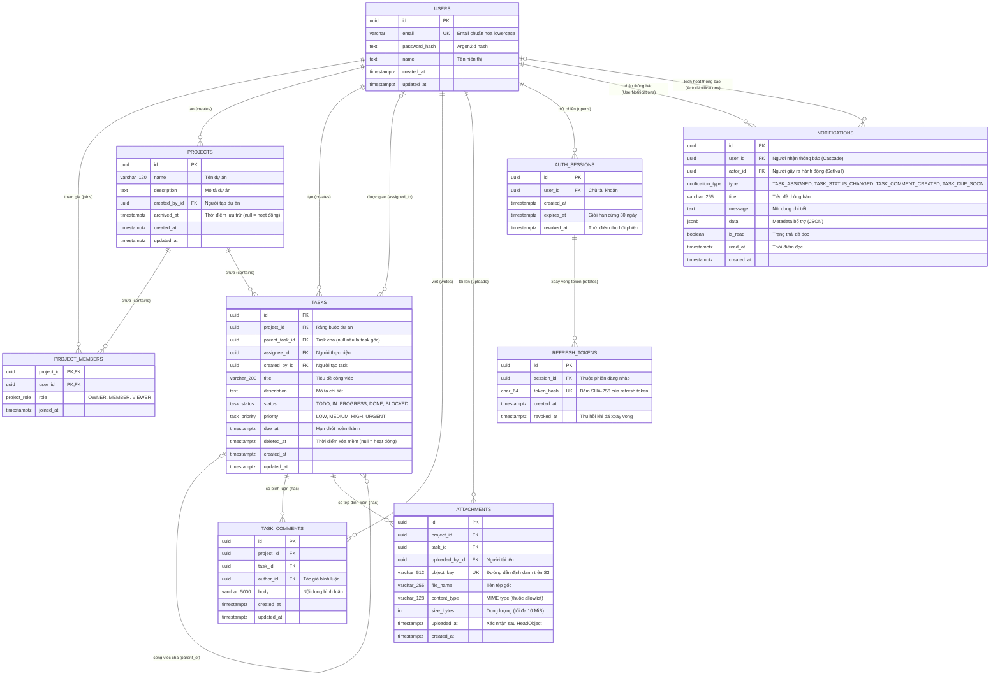

# Thiết kế Cơ sở Dữ liệu TaskFlow (Database Design)

Tài liệu này mô tả chi tiết thiết kế cơ sở dữ liệu của hệ thống TaskFlow trên PostgreSQL 16 và Prisma ORM 7. Nội dung bao gồm sơ đồ quan hệ thực thể (ERD) đầy đủ 9 bảng, định nghĩa kiểu dữ liệu đối chiếu trực tiếp từ các migration thật, vòng đời trạng thái và các bất biến toàn vẹn dữ liệu.

---

## 1. Thông số Công nghệ & Chiến lược Migration

- **Hệ quản trị CSDL**: PostgreSQL 16.
- **ORM & Quản lý Schema**: Prisma ORM 7 (`backend/prisma/schema.prisma`), module format CJS, client sinh tại `backend/src/generated/prisma`.
- **Lịch sử các Migration thật** (`backend/prisma/migrations/`):
  1. `20261016021415_init`: Khởi tạo bảng `users`.
  2. `20261016121107_application_core`: Khởi tạo `projects`, `project_members`, `tasks`, các enum `project_role`, `task_status`, `task_priority`.
  3. `20261016121500_auth_sessions`: Khởi tạo `auth_sessions` và `refresh_tokens`.
  4. `20261023010000_collaboration`: Khởi tạo `task_comments` và `attachments`.
  5. `20261101000000_notifications`: Khởi tạo bảng `notifications` và enum `notification_type`.
- **Nguyên tắc Migration**: Tuyệt đối không sửa đổi các file migration đã phát hành và không reset volume dữ liệu production. Mọi thay đổi cấu trúc đều phải đi qua file migration mới theo hướng an toàn dữ liệu và tương thích ngược.

---

## 2. Sơ đồ Quan hệ Thực thể (ERD Đầy đủ)



---

## 3. Chi tiết Bảng & Đối chiếu Migration thật

### 3.1. Các Kiểu Liệt kê (Enums)
- **`project_role`**: `OWNER`, `MEMBER`, `VIEWER` (gán trong bảng `project_members`).
- **`task_status`**: `TODO`, `IN_PROGRESS`, `DONE`, `BLOCKED` (gán trong bảng `tasks`).
- **`task_priority`**: `LOW`, `MEDIUM`, `HIGH`, `URGENT` (gán trong bảng `tasks`).
- **`notification_type`**: `TASK_ASSIGNED`, `TASK_STATUS_CHANGED`, `TASK_COMMENT_CREATED`, `TASK_DUE_SOON` (gán trong bảng `notifications`).

### 3.2. Danh mục Chỉ mục Hiệu năng (Indexes)
Nhằm đảm bảo tốc độ truy vấn khi dữ liệu tăng trưởng, các index sau được thiết lập trực tiếp trong schema:

| Bảng | Tên Index / Cột Index | Mục đích sử dụng |
|---|---|---|
| `users` | `users_email_key` (`email` UNIQUE) | Tìm kiếm và đăng nhập người dùng nhanh theo email. |
| `projects` | `projects_created_by_id_idx` (`created_by_id`) | Lấy danh sách dự án do người dùng tạo. |
| `projects` | `projects_archived_at_idx` (`archived_at`) | Lọc dự án đang hoạt động (`archived_at IS NULL`). |
| `project_members` | `project_members_pkey` (`project_id`, `user_id`) | Khóa chính phức hợp, đảm bảo 1 user chỉ có 1 role trong 1 project. |
| `project_members` | `project_members_user_id_idx` (`user_id`) | Lấy nhanh toàn bộ dự án mà một người dùng tham gia. |
| `project_members` | `project_members_project_id_role_idx` (`project_id`, `role`) | Kiểm tra vai trò và tìm chủ sở hữu (`OWNER`) của dự án. |
| `tasks` | `tasks_project_id_id_key` (`project_id`, `id` UNIQUE) | Ràng buộc then chốt đảm bảo dữ liệu phụ thuộc (sub-task, comment, attachment) không bao giờ bị lẫn chéo dự án. |
| `tasks` | `tasks_project_id_status_deleted_at_idx` (`project_id`, `status`, `deleted_at`) | Tối ưu hiển thị bảng kéo-thả Kanban và lọc task đang hoạt động. |
| `tasks` | `tasks_project_id_due_at_idx` (`project_id`, `due_at`) | Thống kê task quá hạn và sắp đến hạn cho Dashboard metrics. |
| `tasks` | `tasks_assignee_id_status_idx` (`assignee_id`, `status`) | Tính toán khối lượng công việc phân bổ theo từng thành viên. |
| `tasks` | `tasks_parent_task_id_idx` (`parent_task_id`) | Truy vấn danh sách công việc con (sub-tasks). |
| `task_comments` | `task_comments_project_id_task_id_created_at_idx` | Lấy luồng bình luận theo thứ tự thời gian tăng dần trong một task. |
| `attachments` | `attachments_object_key_key` (`object_key` UNIQUE) | Định danh độc nhất của object trên S3. |
| `attachments` | `attachments_project_id_task_id_created_at_idx` | Lấy danh sách tệp đính kèm trong task. |
| `auth_sessions` | `auth_sessions_user_id_revoked_at_idx` (`user_id`, `revoked_at`) | Kiểm tra phiên hợp lệ của người dùng. |
| `refresh_tokens` | `refresh_tokens_token_hash_key` (`token_hash` UNIQUE) | Tra cứu token xoay vòng theo mã băm SHA-256. |
| `refresh_tokens` | `refresh_tokens_session_id_revoked_at_idx` | Lấy danh sách token đang hoạt động trong phiên. |
| `notifications` | `notifications_user_id_is_read_created_at_idx` (`user_id`, `is_read`, `created_at`) | Tối ưu đếm số lượng thông báo chưa đọc và hiển thị dropdown theo thời gian giảm dần. |

---

## 4. Vòng đời Trạng thái Thực thể (State Lifecycles)

### 4.1. Vòng đời Trạng thái Công việc (Task Status & Kanban)
```text
      ┌───────────────┐
      │     TODO      │ ◄──────────┐
      └───────┬───────┘            │
              │ (kéo-thả/cập nhật) │
              ▼                    │
      ┌───────────────┐            │
      │  IN_PROGRESS  │ ───────────┤
      └───────┬───────┘            │
              ├────────────┐       │
              ▼            ▼       │
      ┌───────────────┐  ┌─────────┴─────┐
      │     DONE      │  │    BLOCKED    │
      └───────────────┘  └───────────────┘
```
- **Quy tắc chuyển đổi**: Người dùng giữ vai trò `OWNER` hoặc `MEMBER` có thể tự do chuyển đổi giữa 4 trạng thái `TODO`, `IN_PROGRESS`, `DONE`, `BLOCKED`. Khi kéo-thả trên giao diện Kanban, API gửi trạng thái mới qua `PATCH /projects/:projectId/tasks/:taskId`.

### 4.2. Vòng đời Xóa mềm Công việc (Task Soft Deletion)
- **Hoạt động (`deletedAt = null`)**: Trạng thái mặc định khi tạo mới. Task hiển thị trên danh sách chính, bảng Kanban và tính vào Dashboard metrics.
- **Xóa mềm (`deletedAt = timestamp`)**: Đưa task vào danh sách "Đã xóa" (`includeDeleted=true`). Dữ liệu bình luận, tệp đính kèm và sub-task liên quan được bảo toàn nguyên vẹn.
- **Khôi phục (`deletedAt = null`)**: Đưa task trở lại bảng làm việc bình thường.

### 4.3. Vòng đời Lưu trữ Dự án (Project Archiving)
- **Hoạt động (`archivedAt = null`)**: Dự án mở cho các thao tác đọc và ghi theo vai trò.
- **Lưu trữ (`archivedAt = timestamp`)**: Dự án được đóng băng. Toàn bộ thành viên (kể cả Owner) chỉ có quyền đọc; mọi request thay đổi dữ liệu (task, comment, attachment) đều bị từ chối với mã lỗi HTTP 400.
- **Khôi phục (`archivedAt = null`)**: Chỉ `OWNER` mới có quyền kích hoạt API khôi phục dự án.

### 4.4. Vòng đời Phiên làm việc & Token Xoay vòng (Session & Token Rotation)
```text
[Đăng nhập] ──> Tạo AuthSession (expires_at = now + 30 ngày)
                     │
                     ▼
           Tạo RefreshToken_1 (token_hash_1, revoked_at = null)
                     │
          (Gọi API POST /auth/refresh)
                     │
                     ├─► Cũ: RefreshToken_1.revoked_at = now()
                     └─► Mới: Tạo RefreshToken_2 (token_hash_2, revoked_at = null)
                     │
           (Phát hiện Replay Attack: Dùng lại RefreshToken_1)
                     │
                     ▼
       AuthSession.revoked_at = now() (Thu hồi toàn bộ phiên đăng nhập)
```

### 4.5. Vòng đời Xác thực Tệp đính kèm (Attachment Verification)
- **Chờ tải (`uploadedAt = null`)**: Bản ghi metadata được tạo tạm thời khi cấp Presigned URL tải lên.
- **Kích hoạt (`uploadedAt = timestamp`)**: Chỉ sau khi trình duyệt tải tệp thành công lên S3 và gọi API xác nhận; backend thực hiện S3 `HeadObject` xác minh tệp tồn tại thực tế và có dung lượng hợp lệ thì mới cập nhật `uploadedAt`.

### 4.6. Vòng đời Thông báo (Notification Read State)
- **Chưa đọc (`isRead = false, readAt = null`)**: Đóng góp vào số lượng đếm hiển thị trên badge chuông thông báo.
- **Đã đọc (`isRead = true, readAt = timestamp`)**: Được đánh dấu khi người dùng click xem thông báo hoặc bấm "Đánh dấu tất cả là đã đọc".

---

## 5. Các Bất biến Toàn vẹn Dữ liệu (Data Invariants)

Để ngăn ngừa lỗi rò rỉ dữ liệu chéo (cross-project data leak) và vi phạm logic nghiệp vụ, cơ sở dữ liệu và mã nguồn cùng thực thi các bất biến sau:

1. **Bất biến Cách ly Dự án (Project Isolation)**:
   - Khóa ngoại giữa `tasks` (con) và `tasks` (cha) ràng buộc theo cặp: `FOREIGN KEY (project_id, parent_task_id) REFERENCES tasks(project_id, id) ON DELETE RESTRICT`. Điều này đảm bảo công việc con bắt buộc phải cùng dự án với công việc cha.
   - Các bảng phụ thuộc `task_comments` và `attachments` đều chứa cả hai cột `project_id` và `task_id`, liên kết chặt chẽ tới khóa phức hợp `(project_id, id)` của bảng `tasks`.
2. **Bất biến Một Chủ sở hữu Duy nhất (Single Owner Invariant)**:
   - Mỗi dự án tại mọi thời điểm luôn tồn tại đúng một bản ghi `project_members` có `role = 'OWNER'`.
   - Khi chuyển quyền sở hữu, logic backend bắt buộc chạy trong transaction để đồng thời thăng cấp thành viên mới và hạ cấp Owner cũ về `MEMBER`. Owner không thể tự rời nhóm nếu chưa chuyển quyền.
3. **Bất biến Công việc con Tối đa Một Cấp (Max 1-level Sub-task)**:
   - Một task có `parentTaskId != null` tuyệt đối không được phép làm task cha cho một task khác. Logic này được chặn ngay tại tầng Service (`TaskService.create`).
4. **Bất biến Giới hạn Tuyệt đối của Phiên (Session Cap Invariant)**:
   - Cột `auth_sessions.expires_at` có giá trị cố định `createdAt + 30 days`. Logic xoay vòng Refresh token tuyệt đối không cập nhật cột này nhằm đảm bảo phiên làm việc bị chấm dứt bắt buộc sau 30 ngày.
5. **Bất biến Chống Tấn công Phát lại Token (Replay Detection Invariant)**:
   - Nếu một `RefreshToken` có `revokedAt != null` được gửi tới endpoint làm mới token, hệ thống lập tức thu hồi toàn bộ `AuthSession` bằng cách cập nhật `auth_sessions.revokedAt = now()`.
6. **Bất biến Chuẩn hóa Email (Email Canonicalization)**:
   - Email người dùng luôn được hàm tiện ích chuẩn hóa về chữ thường (`email.trim().toLowerCase()`) trước khi thực hiện truy vấn hoặc lưu trữ trong bảng `users`, bảo toàn tính duy nhất mà không phụ thuộc extension ngoài của PostgreSQL.
7. **Ràng buộc Xóa Dữ liệu (Cascade / Restrict Rules)**:
   - Xóa `User`: Cascade xóa `auth_sessions` (và `refresh_tokens`), cascade xóa `notifications` nhận; nhưng `RESTRICT` đối với `projects`, `tasks`, `comments`, `attachments` đã tạo để bảo vệ toàn vẹn lịch sử dữ liệu nhóm.
   - Xóa `Project`: `RESTRICT` nếu còn thành viên hoặc task. Dự án được quản lý qua cơ chế lưu trữ (`archivedAt`) thay vì xóa vật lý.

---

## 6. Tài liệu Liên quan

- [Mục lục Tài liệu](../README.md)
- [Trạng thái Hệ thống](../STATE.md)
- [Tổng quan Sản phẩm](../overview/product-overview.md)
- [Thiết kế Kiến trúc Hệ thống](system-design.md)
- [Quyết định Kiến trúc (ADR)](decisions.md)
- [Vấn đề Tồn đọng & Điểm lệch Kỹ thuật](../project/known-issues.md)
- [Lộ trình Phát triển](../project/roadmap.md)
