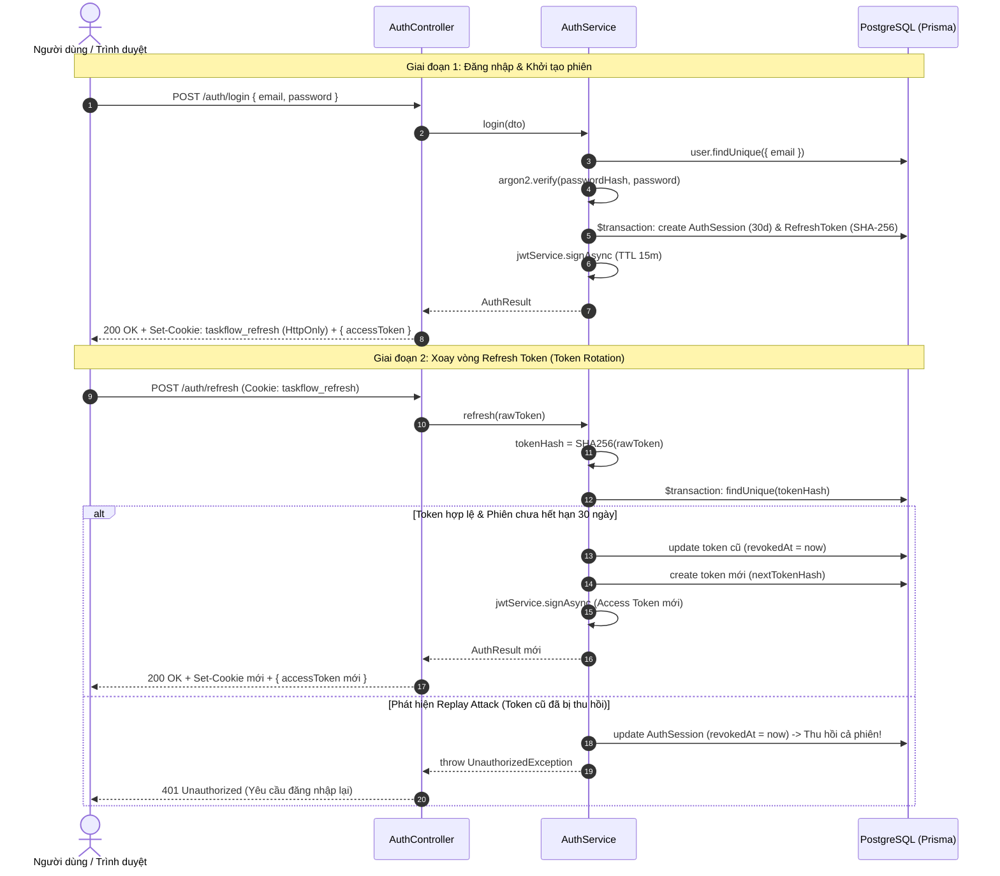
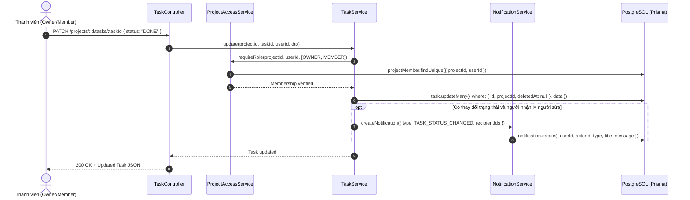
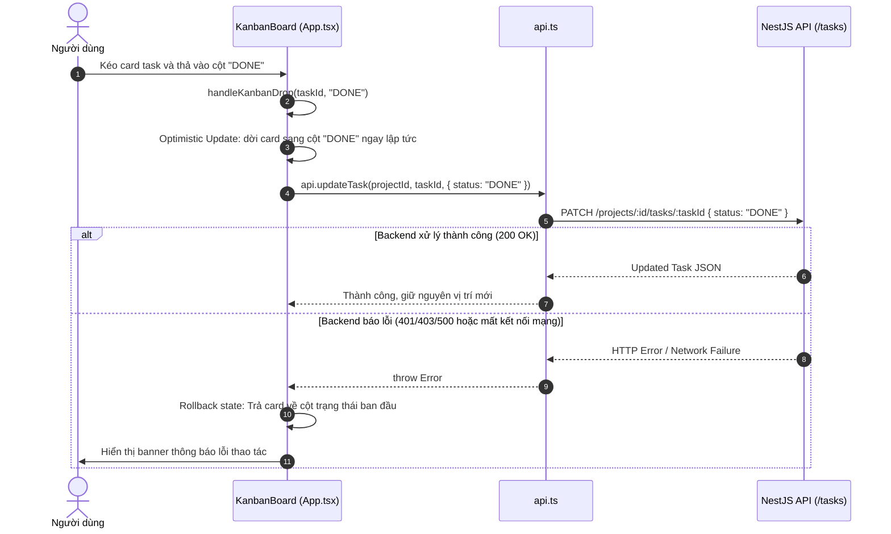
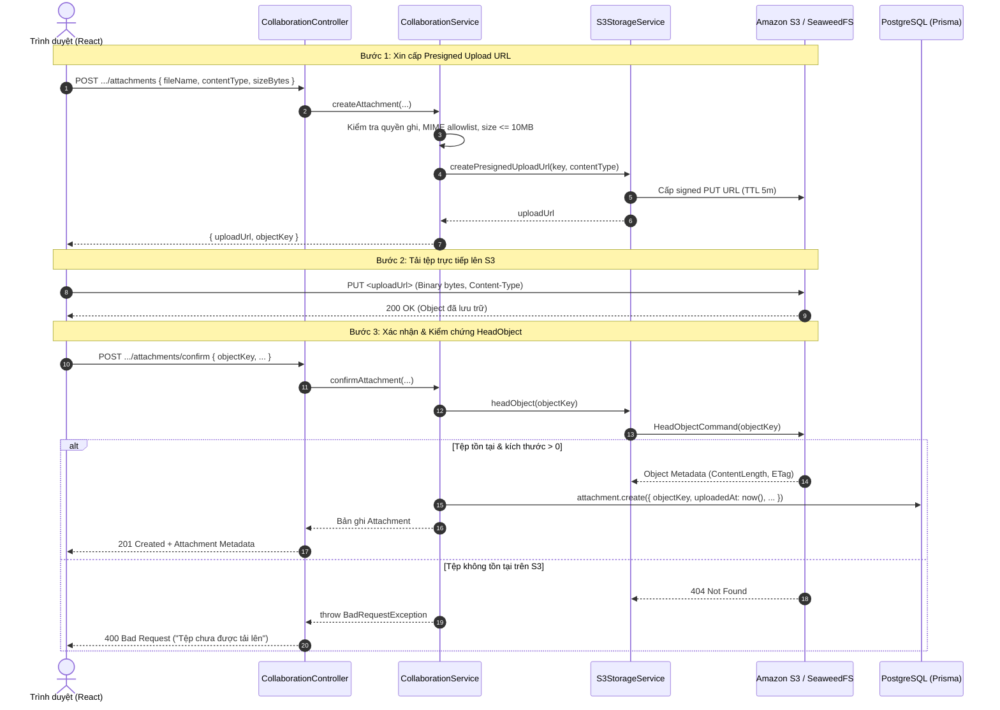
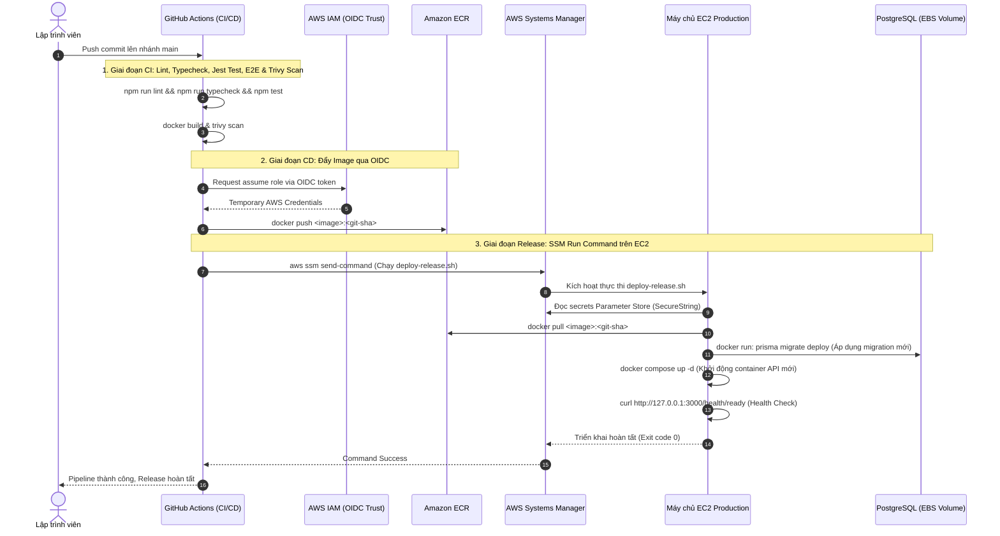

# Đặc tả Các Luồng Hoạt động Trọng yếu (Architectural Flows)

Tài liệu này đặc tả chi tiết 5 luồng hoạt động then chốt của hệ thống TaskFlow: từ xác thực phiên làm việc, quản lý công việc gắn liền thông báo, bảng kéo-thả Kanban, tải tệp đính kèm an toàn qua S3 đến chu trình phát hành tự động CI/CD. Mỗi luồng được mô tả qua điểm vào, các bước thực thi theo file/hàm thật, sơ đồ tuần tự Mermaid, nhánh lỗi và các tác dụng phụ của hệ thống.

---

## 1. Luồng Xác thực & Xoay vòng Token (Auth & Token Rotation)

Luồng đảm bảo việc cấp phát và làm mới phiên đăng nhập an toàn theo mô hình token kép (Dual-token pattern), áp dụng thuật toán băm mật khẩu Argon2id, cookie `HttpOnly` và cơ chế tự động hủy phiên khi phát hiện tấn công phát lại (Replay Attack).

### 1.1. Điểm vào (Entry Points)
- **Đăng ký tài khoản**: `POST /auth/register` $\rightarrow$ `AuthController.register` (`backend/src/auth/auth.controller.ts`)
- **Đăng nhập**: `POST /auth/login` $\rightarrow$ `AuthController.login` (`backend/src/auth/auth.controller.ts`)
- **Làm mới phiên (Token Rotation)**: `POST /auth/refresh` $\rightarrow$ `AuthController.refresh` (`backend/src/auth/auth.controller.ts`)
- **Đăng xuất**: `POST /auth/logout` $\rightarrow$ `AuthController.logout` (`backend/src/auth/auth.controller.ts`)

### 1.2. Các bước thực thi theo hàm/file thật
1. **Đăng nhập (`AuthService.login` trong `backend/src/auth/auth.service.ts`)**:
   - Nhận DTO từ `LoginDto`, chuẩn hóa email về chữ thường qua `AuthService.normalizeEmail`.
   - Tìm người dùng trong cơ sở dữ liệu qua `PrismaService.user.findUnique`.
   - *Khẳng định bảo mật băm Argon2id và chống Timing Attack*: Mật khẩu được băm bằng thuật toán Argon2id (`type: argon2.argon2id` trong `backend/src/auth/auth.service.ts`). Nếu không tìm thấy người dùng, hệ thống vẫn thực thi hàm xác minh mật khẩu giả lập `argon2.verify(dummyPasswordHash, dto.password)` (khai báo tại `const dummyPasswordHash = argon2.hash(...)` trong `backend/src/auth/auth.service.ts`) để đảm bảo thời gian xử lý đồng nhất, chống timing attack.
   - Nếu mật khẩu khớp, gọi hàm khởi tạo phiên `AuthService.startSession`.
   - *Khẳng định bảo mật giới hạn phiên 30 ngày*: Trong transaction cơ sở dữ liệu, bản ghi `AuthSession` được tạo với `expiresAt = now + 30 days` (`SESSION_TTL_MILLISECONDS = 30 * 24 * 60 * 60 * 1000` trong `backend/src/auth/auth.service.ts`).
   - Bản ghi `RefreshToken` đầu tiên được tạo lưu mã băm `token_hash = SHA256(rawToken)` (`createHash('sha256')` trong `backend/src/auth/auth.service.ts`).
   - *Khẳng định bảo mật thời hạn JWT Access Token (15 phút)*: Sinh JWT Access Token qua `JwtService.signAsync` với `expiresIn: ACCESS_TOKEN_TTL_SECONDS` (`const ACCESS_TOKEN_TTL_SECONDS = 15 * 60` tức 900 giây / 15 phút trong `backend/src/auth/auth.service.ts`).
   - Trả về payload cho controller. `AuthController.respondWithSession` ghi cookie `taskflow_refresh` (`httpOnly: true`, `sameSite: 'lax'`, `path: '/auth'`, `secure: production` trong `backend/src/auth/auth.controller.ts`) và trả JWT trong body.
2. **Xoay vòng Token (`AuthService.refresh` trong `backend/src/auth/auth.service.ts`)**:
   - Trích xuất cookie `taskflow_refresh` từ request. Tính `tokenHash = SHA256(rawToken)`.
   - Sinh trước một refresh token ngẫu nhiên mới `nextRawToken` và mã băm `nextTokenHash`.
   - Mở database transaction `PrismaService.$transaction`:
     - Tra cứu `RefreshToken` theo `tokenHash` kèm quan hệ `session` và `user`.
     - *Khẳng định bảo mật cơ chế phát hiện Replay Attack*: Nếu `token.revokedAt != null` hoặc `token.session.revokedAt != null` (dấu hiệu refresh token cũ bị dùng lại), hệ thống lập tức thu hồi toàn bộ phiên làm việc bằng cách gọi `transaction.authSession.update({ where: { id: token.sessionId }, data: { revokedAt: now } })` trong `backend/src/auth/auth.service.ts`.
     - *Kiểm tra hết hạn phiên tuyệt đối*: Nếu `session.expiresAt <= now`, từ chối làm mới.
     - *Xoay vòng nguyên tử*: Cập nhật thu hồi token cũ `refreshToken.updateMany({ where: { id: token.id, revokedAt: null }, data: { revokedAt: now } })`. Nếu số lượng cập nhật khác 1 (xung đột tranh chấp), hủy toàn bộ phiên.
     - Tạo bản ghi token mới `refreshToken.create({ data: { sessionId: token.sessionId, tokenHash: nextTokenHash } })`.
   - Sinh Access Token mới (thời hạn 15 phút) và trả về kèm cookie `taskflow_refresh` mới.

### 1.3. Sơ đồ tuần tự (Sequence Diagram)

### 1.4. Nhánh lỗi (Error Branches)
- `401 Unauthorized`: Mật khẩu sai, tài khoản không tồn tại, refresh token bị thiếu, token đã hết hạn 30 ngày hoặc token đã bị thu hồi (Replay attack).
- `409 Conflict`: Khi đăng ký tài khoản mới với email đã tồn tại trong database (`P2002` Prisma unique constraint).
- `400 Bad Request`: Dữ liệu đầu vào không thỏa mãn validation (email sai định dạng, mật khẩu ngắn dưới 8 ký tự).

### 1.5. Tác dụng phụ (Side Effects)
- Ghi bản ghi vào bảng `auth_sessions` và `refresh_tokens`.
- Đặt hoặc làm mới cookie `taskflow_refresh` trên trình duyệt.
- Thu hồi phiên ngay lập tức khi phát hiện token cũ bị dùng lại.

---

## 2. Luồng Quản lý Công việc & Kích hoạt Thông báo (Task Lifecycle & Notifications)

Luồng xử lý việc tạo mới, gán người thực hiện, cập nhật trạng thái công việc và tự động phát sinh các thông báo in-app tương ứng cho các thành viên liên quan.

### 2.1. Điểm vào (Entry Points)
- **Tạo công việc**: `POST /projects/:projectId/tasks` $\rightarrow$ `TaskController.create` (`backend/src/tasks/task.controller.ts`)
- **Cập nhật công việc**: `PATCH /projects/:projectId/tasks/:taskId` $\rightarrow$ `TaskController.update` (`backend/src/tasks/task.controller.ts`)

### 2.2. Các bước thực thi theo hàm/file thật
1. **Tạo Task (`TaskService.create` trong `backend/src/tasks/task.service.ts`)**:
   - Kiểm tra quyền: Gọi `ProjectAccessService.requireRole(projectId, userId, [OWNER, MEMBER])`. Viewer bị từ chối với lỗi 403.
   - Ràng buộc phân cấp: Nếu có `parentTaskId`, truy vấn `prisma.task.findFirst` kiểm tra task cha tồn tại trong cùng dự án, chưa bị xóa mềm (`deletedAt = null`) và không phải là một sub-task (`parentTask.parentTaskId === null`).
   - Kiểm tra người được giao: Nếu có `assigneeId`, kiểm tra người đó đã tham gia dự án qua `prisma.projectMember.findUnique`.
   - Tạo task: Lưu bản ghi vào bảng `tasks` qua `prisma.task.create`.
   - Kích hoạt thông báo: Nếu `assigneeId` khác người tạo (`assigneeId !== userId`), gọi `NotificationService.createNotification` với loại `TASK_ASSIGNED`. Bản ghi `notifications` được tạo trong database.
2. **Cập nhật Task (`TaskService.update` trong `backend/src/tasks/task.service.ts`)**:
   - Kiểm tra quyền ghi của người gọi qua `ProjectAccessService.requireRole`.
   - Kiểm tra tính bất biến: Không cho phép đổi task cha (`parentTaskId`).
   - Thực thi cập nhật: `prisma.task.updateMany({ where: { id: taskId, projectId, deletedAt: null }, data: ... })`.
   - Kích hoạt thông báo:
     - Nếu đổi sang `assigneeId` mới khác người thực hiện thao tác: Kích hoạt thông báo `TASK_ASSIGNED` cho người mới.
     - Nếu đổi `status`: Thu thập danh sách người nhận gồm người được giao (`assigneeId`) và người tạo task (`createdById`) (loại trừ chính người đang thao tác). Gọi `NotificationService.createNotification` với loại `TASK_STATUS_CHANGED`.

### 2.3. Sơ đồ tuần tự (Sequence Diagram)

### 2.4. Nhánh lỗi (Error Branches)
- `401 Unauthorized`: Thiếu hoặc access token JWT không hợp lệ.
- `403 Forbidden`: Người dùng là `VIEWER` hoặc không thuộc dự án.
- `404 Not Found`: Task không tồn tại hoặc đã bị xóa mềm trong dự án.
- `400 Bad Request`: Task cha không hợp lệ (thuộc dự án khác hoặc là sub-task cấp 2), hoặc người được giao không phải thành viên dự án.

### 2.5. Tác dụng phụ (Side Effects)
- Cập nhật dòng dữ liệu tương ứng trong bảng `tasks`.
- Tự động chèn bản ghi mới vào bảng `notifications` cho các thành viên liên quan.

---

## 3. Luồng Tương tác Kéo-thả Bảng Kanban (Kanban Drag & Drop)

Luồng thể hiện sự phối hợp giữa giao diện người dùng frontend (phản hồi trực quan tức thời) và backend API đảm bảo tính nhất quán dữ liệu.

### 3.1. Điểm vào (Entry Points)
- **Tương tác giao diện**: Thao tác kéo thẻ công việc và thả vào một trong 4 cột trạng thái trên giao diện `KanbanBoard` (`frontend/src/App.tsx`).
- **Gọi API**: `api.updateTask(projectId, taskId, { status: targetStatus })` (`frontend/src/api.ts`).

### 3.2. Các bước thực thi theo hàm/file thật
1. **Bắt đầu kéo (`onDragStart` trong `frontend/src/App.tsx`)**:
   - Kiểm tra `canEdit` (chỉ cho phép nếu vai trò là `OWNER` hoặc `MEMBER`).
   - Thiết lập dữ liệu kéo qua `e.dataTransfer.setData('text/plain', task.id)` và `effectAllowed = 'move'`.
2. **Kéo qua cột đích (`onDragOver` & `onDragEnter`)**:
   - Ngăn chặn hành vi mặc định `e.preventDefault()`.
   - Cập nhật state `activeDropColumn` để đổi màu viền cột đích (drag hint).
3. **Thả thẻ công việc (`onDrop` $\rightarrow$ `handleKanbanDrop` trong `frontend/src/App.tsx`)**:
   - Trích xuất `taskId` từ data transfer. Nếu `task.status === targetStatus`, hủy thao tác.
   - *Lưu ý quan trọng về thứ tự thẻ*: Thao tác kéo-thả hiện tại **chỉ thay đổi trạng thái cột (`status`)**, hoàn toàn **chưa hỗ trợ sắp xếp thứ tự tùy ý giữa các task trong cùng một cột** (do bảng `tasks` trong database chưa có trường `position`, xem thêm tại [`docs/project/roadmap.md`](../project/roadmap.md)). Thứ tự hiển thị thẻ trong cột hiện tại phụ thuộc vào thứ tự thời gian tạo (`createdAt desc`).
   - **Cập nhật lạc quan (Optimistic Update)**: Gọi `setTasks(prev => prev.map(t => t.id === taskId ? { ...t, status: targetStatus } : t))`. Thẻ công việc lập tức nhảy sang cột mới trên màn hình.
   - Gửi request ngầm: Gọi `api.updateTask(projectId, taskId, { status: targetStatus })`.
   - Backend xử lý: `TaskController.update` cập nhật database và sinh thông báo `TASK_STATUS_CHANGED`.
   - **Xử lý khi có lỗi (Rollback)**: Nếu API trả về lỗi (mất mạng, hết hạn phiên hoặc quyền Viewer), khối `catch (requestError)` bắt lỗi, hiển thị thông báo lỗi trên thanh toolbar và khôi phục lại danh sách task ban đầu.

### 3.3. Sơ đồ tuần tự (Sequence Diagram)

### 3.4. Nhánh lỗi (Error Branches)
- Lỗi mạng hoặc HTTP 401/403: Frontend bắt lỗi trong `handleKanbanDrop`, hoàn tác trạng thái state `tasks` về ban đầu và hiển thị thông điệp lỗi cho người dùng.

### 3.5. Tác dụng phụ (Side Effects)
- Đổi trạng thái `status` của task trong bảng `tasks` ở cơ sở dữ liệu.
- Kích hoạt thông báo in-app tới người tạo và người thực hiện task.

---

## 4. Luồng Tải lên Tệp đính kèm an toàn qua S3 Presigned URL (Secure S3 Upload)

Quy trình 3 bước đảm bảo tệp nhị phân được truyền trực tiếp giữa trình duyệt và S3 mà không đi qua server API, giúp giảm tải băng thông và bộ nhớ cho máy chủ backend, đồng thời kiểm duyệt chặt chẽ định dạng, dung lượng và sự tồn tại thực tế của tệp.

### 4.1. Điểm vào (Entry Points)
- **Bước 1 (Cấp Presigned URL)**: `POST /projects/:projectId/tasks/:taskId/attachments` $\rightarrow$ `CollaborationController.createAttachment` (`backend/src/collaboration/collaboration.controller.ts`)
- **Bước 2 (Upload trực tiếp)**: HTTP `PUT <presigned-url>` trực tiếp từ trình duyệt tới S3 Storage (`frontend/src/api.ts`).
- **Bước 3 (Xác nhận và kích hoạt)**: `POST /projects/:projectId/tasks/:taskId/attachments/confirm` $\rightarrow$ `CollaborationController.confirmAttachment` (`backend/src/collaboration/collaboration.controller.ts`)

### 4.2. Các bước thực thi theo hàm/file thật
1. **Khởi tạo và xin Presigned URL (`CollaborationService.createAttachment` trong `backend/src/collaboration/collaboration.service.ts`)**:
   - Kiểm tra quyền: `ProjectAccessService.requireRole(projectId, userId, [OWNER, MEMBER])`.
   - *Khẳng định bảo mật giới hạn dung lượng 10 MiB*: Kiểm tra `sizeBytes <= 10 * 1024 * 1024` (tối đa 10 MiB, khai báo tường minh trong `backend/src/collaboration/collaboration.service.ts`).
   - Kiểm tra MIME allowlist: So sánh `contentType` với danh sách cấu hình qua `ConfigService` (`S3_ALLOWED_CONTENT_TYPES`).
   - Sinh object key duy nhất: `projects/${projectId}/tasks/${taskId}/${randomUUID()}-${safeFileName}`.
   - *Khẳng định bảo mật thời hạn Presigned URL (5 phút)*: Gọi `S3StorageService.createPresignedUploadUrl` (khai báo tường minh `{ expiresIn: 300 }` tức 300 giây / 5 phút trong `backend/src/collaboration/s3-storage.service.ts`). Tương tự, URL tải xuống trong `createPresignedDownloadUrl` cũng áp dụng `{ expiresIn: 300 }` trong `backend/src/collaboration/s3-storage.service.ts`.
   - Trả về `uploadUrl` và `objectKey` cho client.
2. **Tải dữ liệu lên S3 từ trình duyệt**:
   - Client thực hiện `fetch(uploadUrl, { method: 'PUT', headers: { 'Content-Type': file.type }, body: file })` truyền trực tiếp dữ liệu nhị phân lên kho lưu trữ (SeaweedFS ở local hoặc Amazon S3 ở production).
3. **Xác thực và lưu bản ghi (`CollaborationService.confirmAttachment` trong `backend/src/collaboration/collaboration.service.ts`)**:
   - Client gửi request confirm kèm `objectKey`, `fileName`, `contentType`, `sizeBytes`.
   - Backend gọi `S3StorageService.headObject(objectKey)`: Gửi lệnh `HeadObjectCommand` tới S3 để truy vấn metadata tệp trên storage.
   - Nếu S3 báo tệp không tồn tại hoặc `ContentLength === 0`, từ chối kích hoạt.
   - Nếu xác minh hợp lệ: Tạo bản ghi vào bảng `attachments` qua `prisma.attachment.create` với `uploadedAt = now()`.

### 4.3. Sơ đồ tuần tự (Sequence Diagram)

### 4.4. Nhánh lỗi (Error Branches)
- `400 Bad Request`: Dung lượng tệp > 10 MiB, MIME type không thuộc danh sách cho phép, hoặc lệnh `HeadObject` tới S3 thất bại (người dùng chưa upload tệp hoặc upload bị hủy giữa chừng).
- `403 Forbidden`: Người dùng là `VIEWER` hoặc không thuộc dự án.
- Lỗi mạng S3: Lỗi kết nối hoặc CORS cấu hình sai trên S3 bucket khiến trình duyệt không thể hoàn thành lệnh `PUT`.

### 4.5. Tác dụng phụ (Side Effects)
- Lưu trữ bytes nhị phân trong bucket S3 riêng tư.
- Tạo một bản ghi mới trong bảng `attachments` của database.

---

## 5. Luồng Tích hợp & Triển khai Liên tục (CI $\rightarrow$ CD $\rightarrow$ SSM Release)

Chu trình phát hành tự động hóa khép kín: từ kiểm thử mã nguồn, quét lỗ hổng bảo mật, đóng gói container đến kích hoạt triển khai lên máy chủ EC2 mà không lưu trữ static credential trên GitHub Actions.

### 5.1. Điểm vào (Entry Points)
- **CI Trigger**: Sự kiện tạo Pull Request hoặc Push code lên bất kỳ nhánh nào (`.github/workflows/ci.yml`).
- **CD Trigger**: Sự kiện Push (hoặc Merge PR) vào nhánh `main` sau khi toàn bộ job CI đã vượt qua (`.github/workflows/cd.yml`).

### 5.2. Các bước thực thi theo hàm/file thật
1. **Kiểm thử & Quét an ninh CI (`.github/workflows/ci.yml`)**:
   - Job `test`: Chạy `npm run lint` (`oxlint`), `npm run typecheck` (`tsc`), và `npm test` (`jest`).
   - Job `e2e`: Khởi chạy service container PostgreSQL, áp dụng migration `prisma migrate deploy`, chạy bộ kiểm thử tích hợp `npm run test:e2e`.
   - Job `image`: Xây dựng Docker image bằng multi-stage build; quét lỗ hổng container bằng công cụ Aqua Security Trivy. Chặn pipeline nếu phát hiện lỗ hổng nghiêm trọng (CRITICAL) đã có bản vá.
2. **Xác thực AWS bằng OIDC & Đẩy Image (`.github/workflows/cd.yml`)**:
   - Sử dụng action `aws-actions/configure-aws-credentials` đóng vai trò IAM OIDC Role (`role-to-assume`), không sử dụng access key tĩnh.
   - Đăng nhập vào Amazon ECR qua `aws-actions/amazon-ecr-login`.
   - Build và gắn tag image theo Git commit SHA và `latest`, sau đó đẩy lên ECR Repository riêng tư.
3. **Kích hoạt Triển khai qua AWS SSM (`.github/workflows/cd.yml` $\rightarrow$ `deploy/deploy-release.sh`)**:
   - GitHub Actions gọi lệnh `aws ssm send-command` với document `AWS-RunShellScript` tới Instance ID của máy chủ EC2 production.
   - Kịch bản triển khai [`deploy/deploy-release.sh`](../../deploy/deploy-release.sh) được thực thi trên máy chủ EC2:
     - Đọc các tham số bảo mật từ AWS SSM Parameter Store (`SecureString`: `DATABASE_URL`, `JWT_ACCESS_SECRET`, `S3_BUCKET`...) và ghi vào tệp `.env.production`.
     - Đăng nhập vào Amazon ECR sử dụng Instance Profile IAM của chính EC2.
     - Kéo bản build image mới nhất từ ECR về máy chủ.
     - Áp dụng migration cơ sở dữ liệu production bằng cách chạy container tạm thời: `docker run ... npx prisma migrate deploy`.
     - Tái khởi động dịch vụ qua Docker Compose: `docker compose -f deploy/compose.production.yaml up -d --remove-orphans api`.
     - Xác thực trạng thái ứng dụng: Gửi request `curl -f http://127.0.0.1:3000/health/ready` kiểm tra kết nối database và `curl http://127.0.0.1:3000/version` đối chiếu Git SHA.

### 5.3. Sơ đồ tuần tự (Sequence Diagram)

### 5.4. Nhánh lỗi (Error Branches)
- Thất bại kiểm thử hoặc quét lỗ hổng Trivy: Pipeline CI dừng ngay lập tức, không kích hoạt CD.
- Lỗi xác thực OIDC: Sai repository subject claim hoặc IAM role cấu hình sai trust policy $\rightarrow$ CD dừng.
- Migration Database thất bại: Lệnh `prisma migrate deploy` trả về lỗi $\rightarrow$ Kịch bản dừng lại, giữ nguyên container API phiên bản cũ đang chạy, không làm gián đoạn hệ thống.
- Health Check thất bại: API container không khởi động được hoặc kết nối DB thất bại $\rightarrow$ Kịch bản trả về exit code 1, SSM đánh dấu lệnh thất bại và ghi nhận vào log.

### 5.5. Tác dụng phụ (Side Effects)
- Lưu image mới trong Amazon ECR Repository (tự động áp dụng lifecycle policy giữ 10 bản mới nhất).
- Cập nhật database schema lên phiên bản migration mới nhất.
- Thay thế tiến trình backend container trên máy chủ EC2 với phiên bản Git SHA mới.
- Ghi nhật ký triển khai trong lịch sử AWS Systems Manager Run Command.

---

## 6. Tài liệu Liên quan

- [Mục lục Tài liệu](../README.md)
- [Trạng thái Hệ thống](../STATE.md)
- [Tổng quan Sản phẩm](../overview/product-overview.md)
- [Thiết kế Kiến trúc Hệ thống](system-design.md)
- [Thiết kế Cơ sở Dữ liệu](database.md)
- [Quyết định Kiến trúc (ADR)](decisions.md)
- [Vấn đề Tồn đọng & Điểm lệch Kỹ thuật](../project/known-issues.md)
- [Lộ trình Phát triển](../project/roadmap.md)
- [Hướng dẫn Triển khai Production](../../deploy/README.md)
- [Hạ tầng AWS bằng Terraform](../../infra/terraform/README.md)
