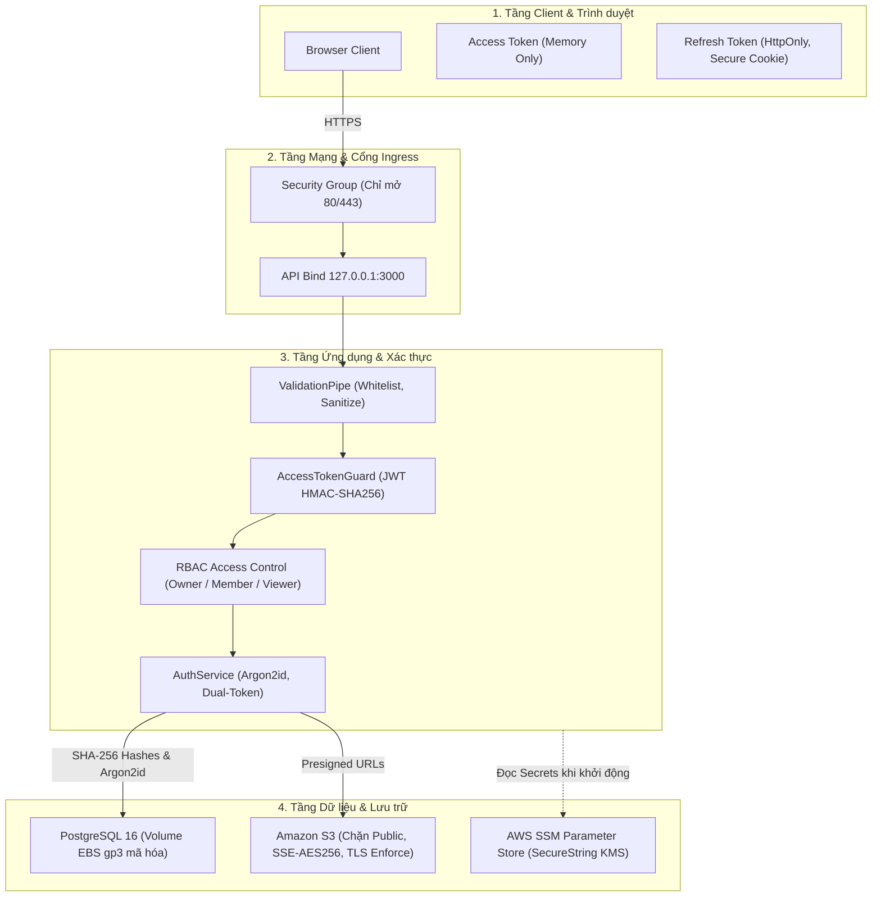
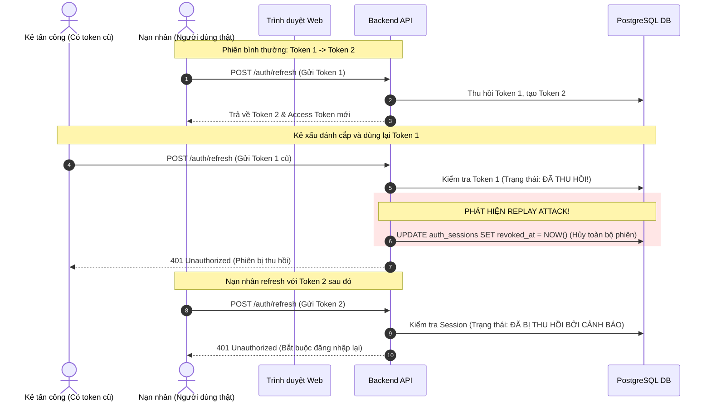

# Kiến trúc An toàn Thông tin & Bảo mật (Security Architecture)

Tài liệu này đặc tả toàn diện kiến trúc an toàn thông tin, các tầng phòng thủ theo chiều sâu (Defense-in-Depth), quy chuẩn mật mã học, kiểm soát truy cập và cơ chế bảo vệ dữ liệu xuyên suốt hệ sinh thái **TaskFlow**.

---

## 1. Nguyên tắc Bảo mật Tổng thể

TaskFlow tuân thủ triệt để các nguyên tắc an ninh thông tin tiêu chuẩn công nghiệp:
- **Phòng thủ theo chiều sâu (Defense in Depth)**: Bảo vệ đa tầng từ hạ tầng mạng, hệ điều hành máy chủ, cơ chế container hóa, kiểm soát truy cập đến mức ứng dụng và cơ sở dữ liệu.
- **Quyền tối thiểu (Principle of Least Privilege - PoLP)**: Cả tài nguyên IAM (EC2, GitHub Actions), quyền truy cập cơ sở dữ liệu và người dùng ứng dụng (RBAC) đều chỉ được cấp phát chính xác những quyền hạn tối thiểu cần thiết để thực hiện nhiệm vụ.
- **Không tin tưởng mặc định (Zero Trust / Assume Breach)**: Dữ liệu nhạy cảm (mật khẩu, refresh token, secrets) không bao giờ được lưu trữ dưới dạng bản rõ (plaintext). Mọi dữ liệu đầu vào từ người dùng đều phải được thẩm định nghiêm ngặt trước khi xử lý.

---

## 2. Xác thực & Quản lý Phiên (Authentication & Session Security)

### 2.1. Băm Mật khẩu bằng Argon2id
Mật khẩu người dùng được băm độc quyền bằng thuật toán **Argon2id** (thuật toán chiến thắng cuộc thi Password Hashing Competition, có khả năng chống tấn công brute-force phần cứng GPU/ASIC và tấn công kênh kề - side-channel attacks).
- Tham số Argon2id tuân thủ khuyến nghị OWASP:
  - Memory cost: 65,536 KiB (64 MiB).
  - Time cost: 3 iterations.
  - Parallelism: 4 luồng.
- **Chống tấn công đo thời gian (Timing Attack Mitigation)**:
  - Trong [`AuthService.login`](../../backend/src/auth/auth.service.ts), khi người dùng nhập email không tồn tại trong hệ thống, hàm không lập tức trả về lỗi mà vẫn thực hiện so sánh với chuỗi hash giả định (`dummyPasswordHash`).
  - Kết quả: Thời gian xử lý của request khi *sai email* và khi *sai mật khẩu* là tương đương nhau (~100-200ms), ngăn chặn kẻ tấn công suy đoán sự tồn tại của tài khoản trong hệ thống thông qua độ trễ phản hồi.
- **Đổi mật khẩu chủ động & Thu hồi phiên tự động**:
  - Khi người dùng đổi mật khẩu qua [`POST /auth/change-password`](../../backend/src/auth/auth.controller.ts), hệ thống xác thực mật khẩu hiện tại bằng Argon2id, ngăn chặn đặt trùng mật khẩu cũ và băm mật khẩu mới bằng Argon2id.
  - Sau khi cập nhật, hệ thống tự động thu hồi (`auth_sessions.revokedAt = now()`) toàn bộ các phiên làm việc khác của người dùng trong cùng transaction, đảm bảo các thiết bị khác bị đăng xuất ngay lập tức.

### 2.2. Kiến trúc Token Kép (Dual-Token Architecture)
Hệ thống sử dụng kết hợp giữa **Access Token ngắn hạn** và **Refresh Token dài hạn xoay vòng**:

| Đặc tính | Access Token | Refresh Token |
|---|---|---|
| **Định dạng** | JSON Web Token (JWT) ký bằng HMAC-SHA256 | Chuỗi ngẫu nhiên 32 bytes (`randomBytes(32)`), mã hóa base64url |
| **Thời hạn sống** | 15 phút (`15m`) | Gắn liền với phiên (`AuthSession`), tối đa 30 ngày tuyệt đối |
| **Vị trí lưu trữ Client** | Bộ nhớ JavaScript (`in-memory`) của ứng dụng React | Cookie `taskflow_refresh` với các cờ bảo mật |
| **Cờ Cookie** | N/A | `HttpOnly: true`, `Secure: true` (production), `SameSite: 'strict'`, `Path: '/auth'` |
| **Lưu trữ Database** | Không lưu | Chỉ lưu mã băm **SHA-256** (`token_hash`) trong bảng `refresh_tokens` |

> [!IMPORTANT]
> **Phạm vi đường dẫn Cookie (`Path: '/auth'`)**: Trình duyệt chỉ đính kèm cookie `taskflow_refresh` trong các yêu cầu gửi đến các endpoint xác thực (`/auth/refresh`, `/auth/logout`). Tất cả các API nghiệp vụ khác (`/projects/...`, `/tasks/...`) hoàn toàn không mang theo cookie này, hạn chế tối đa nguy cơ rò rỉ hoặc bị khai thác CSRF.

### 2.3. Cơ chế Xoay vòng Refresh Token & Phòng chống Tấn công Phát lại (Replay Attack Detection)
Mỗi lần gọi `POST /auth/refresh`:
1. Backend trích xuất token thô từ cookie, tính mã băm SHA-256 và tìm kiếm trong bảng `refresh_tokens`.
2. Kiểm tra trạng thái token:
   - Nếu token **đã bị thu hồi** (`revoked_at != null`): Hệ thống phát hiện **dấu hiệu phiên bị đánh cắp và tấn công phát lại (Replay Attack)**. Ngay lập tức, backend kích hoạt lệnh thu hồi toàn bộ phiên (`auth_sessions.revoked_at = now()`), đồng thời thu hồi mọi refresh token thuộc phiên đó. Cả kẻ tấn công lẫn người dùng hợp pháp đều bị đăng xuất ngay lập tức.
   - Nếu token **chưa bị thu hồi** nhưng phiên đã hết hạn (`session.expires_at < now()`) hoặc phiên đã bị thu hồi: Trả về HTTP 401 Unauthorized.
3. Nếu hợp lệ:
   - Đánh dấu token hiện tại là đã thu hồi: `revoked_at = now()`.
   - Sinh chuỗi ngẫu nhiên 32 bytes mới, tính SHA-256 và lưu bản ghi `RefreshToken` mới kế thừa phiên làm việc.
   - Cấp Access Token JWT mới (15 phút) và đặt lại cookie `taskflow_refresh` mới vào HTTP response header.

### 2.4. Giới hạn Cứng Thời gian Phiên (Absolute Session Timeout)
- Trường `expires_at` của bảng `auth_sessions` được thiết lập cố định là **30 ngày** tính từ thời điểm đăng nhập (`POST /auth/login` hoặc `POST /auth/register`).
- Trong các lần `POST /auth/refresh`, thời hạn `expires_at` của phiên **không bao giờ được gia hạn**. Khi chạm mốc 30 ngày, phiên tự động kết thúc và người dùng bắt buộc phải xác thực lại danh tính.

---

## 3. Phân quyền & Kiểm soát Truy cập (Authorization & RBAC)

### 3.1. Mô hình Phân quyền theo Dự án
TaskFlow áp dụng mô hình phân quyền dựa trên vai trò (Role-Based Access Control - RBAC) cô lập theo từng dự án:

| Quyền hạn | `OWNER` | `MEMBER` | `VIEWER` |
|---|:---:|:---:|:---:|
| Xem chi tiết dự án, task, sub-task, bình luận, tệp | V | V | V |
| Tạo task, tạo sub-task, cập nhật trạng thái/tiến độ task | V | V | X |
| Đăng bình luận vào task | V | V | X |
| Sửa / Xóa bình luận của chính mình | V | V | X |
| Xóa bình luận của thành viên khác | V | X | X |
| Khởi tạo presigned URL & upload tệp đính kèm | V | V | X |
| Xóa tệp đính kèm | V | X | X |
| Thêm / Xóa thành viên dự án, đổi vai trò thành viên | V | X | X |
| Chuyển giao quyền sở hữu dự án (`transfer-owner`) | V | X | X |
| Lưu trữ (Archive) & Khôi phục dự án | V | X | X |
| Xem metrics dashboard & Xuất báo cáo CSV | V | V | V |

### 3.2. Tính Toàn vẹn Dữ liệu Phân quyền
- **Chuyển giao quyền Owner nguyên tử (Atomic Transfer)**: Quá trình chuyển quyền sở hữu dự án (`POST /projects/:projectId/transfer-owner`) được bọc trong một Prisma Database Transaction duy nhất:
  1. Hạ vai trò Owner hiện tại xuống `MEMBER`.
  2. Nâng vai trò của thành viên chỉ định lên `OWNER`.
  3. Cập nhật trường `owner_id` của bảng `projects`.
  -> Đảm bảo tại mọi thời điểm, dự án luôn có duy nhất một Owner hợp lệ.
- **Ràng buộc Khóa ngoại Phức hợp (Composite Foreign Keys)**: Bảng `tasks` có ràng buộc `FOREIGN KEY (project_id, parent_task_id) REFERENCES tasks(project_id, id)`. Điều này ngăn chặn triệt để lỗ hổng Broken Object Level Authorization (BOLA), đảm bảo sub-task không thể liên kết nhầm sang task cha thuộc một dự án khác.

---

## 4. An toàn Tệp đính kèm & Tích hợp S3 (Object Storage Security)

Tệp tải lên là một trong những bề mặt tấn công rủi ro nhất (mã độc, khai thác bộ nhớ server, tấn công lưu trữ). TaskFlow áp dụng mô hình cách ly hoàn toàn qua Amazon S3:

### 4.1. Quy trình Tải tệp Presigned URL 3 Bước
Hệ thống **không nhận luồng tệp (file stream) trực tiếp qua server backend**, loại bỏ hoàn toàn nguy cơ cạn kiệt bộ nhớ RAM hoặc tấn công Denial of Service (DoS) qua multipart upload.
1. **Khởi tạo (`POST /projects/:projectId/tasks/:taskId/attachments/presigned-upload`)**:
   - Backend xác thực quyền `OWNER` hoặc `MEMBER`.
   - Kiểm tra dung lượng khai báo: giới hạn tối đa **10 MiB** (`10 * 1024 * 1024 bytes`).
   - Kiểm tra MIME type theo allowlist nghiêm ngặt: `application/pdf`, `image/gif`, `image/jpeg`, `image/png`, `image/webp`, `text/plain`.
   - Sinh S3 Presigned PUT URL có thời hạn hết hạn ngắn (**5 phút**).
   - Đặt khóa tệp (S3 Object Key) ngẫu nhiên bằng UUIDv4 theo định dạng phân tầng: `projects/{projectId}/tasks/{taskId}/{uuid}-{sanitizedFileName}`. Điều này ngăn chặn kỹ thuật liệt kê tệp (enumeration attacks) và ghi đè tệp.
2. **Tải lên Trực tiếp**: Trình duyệt gửi trực tiếp luồng binary lên endpoint S3 qua HTTPS PUT.
3. **Xác thực Hậu kiểm (`POST /.../confirm`)**:
   - Trước khi lưu metadata vào database, backend gọi lệnh AWS SDK `HeadObject`.
   - Backend xác minh tệp thực sự tồn tại trên S3 và kích thước thực tế (`ContentLength`) không vượt quá 10 MiB.
   - Chỉ khi kiểm tra thành công, bản ghi mới được đánh dấu hoạt động (`uploaded_at = now()`).

### 4.2. Chính sách Bảo mật Bucket S3 (Terraform Enforced)
Trong [`infra/terraform/main.tf`](../../infra/terraform/main.tf):
- **Chặn Hoàn toàn Truy cập Công khai (Block Public Access)**:
  - `block_public_acls = true`
  - `block_public_policy = true`
  - `ignore_public_acls = true`
  - `restrict_public_buckets = true`
- **Bắt buộc Mã hóa Kênh truyền (TLS 1.2+ Enforcement)**: Bucket Policy có điều kiện tường minh từ chối (`Effect: Deny`) mọi yêu cầu không sử dụng HTTPS (`aws:SecureTransport = "false"`).
- **Mã hóa Dữ liệu Lưu trữ (SSE-S3 AES-256)**: Toàn bộ object được tự động mã hóa bằng thuật toán chuẩn AES-256 trước khi ghi vào đĩa lưu trữ của AWS.
- **Chính sách CORS Nghiêm ngặt**: Chỉ cho phép các phương thức `GET, PUT, HEAD`, headers `*`, expose header `ETag`, và giới hạn `allowed_origins` khớp với tên miền của ứng dụng.

---

## 5. An ninh Mạng & Hạ tầng Máy chủ (Infrastructure & Server Security)

### 5.1. Tường lửa & Phân vùng Mạng (Network Isolation)
- **Security Group EC2 (`taskflow-app`)**:
  - Cổng mở ra Internet: Chỉ mở cổng **80 (HTTP)** (cho ACME challenge và redirect sang HTTPS) và **443 (HTTPS)**.
  - Cổng **PostgreSQL (5432)**: Hoàn toàn **không mở cổng ra ngoài** (không có ingress rule, container docker không publish port ra host).
  - Cổng **Backend API (3000)**: Chỉ bind vào loopback nội bộ máy chủ `127.0.0.1:3000`, không thể truy cập trực tiếp từ mạng bên ngoài.
  - Quản trị máy chủ: Không mở cổng SSH (port 22). Mọi thao tác quản trị được thực hiện an toàn qua **AWS Systems Manager (SSM) Session Manager** và **Run Command** thông qua kênh mã hóa outbound HTTPS của SSM Agent.

### 5.2. Quản lý Quyền IAM (Least Privilege IAM Roles)
1. **GitHub Actions OIDC Release Role (`taskflow-github-release`)**:
   - Xác thực qua nhà cung cấp OIDC chuẩn của GitHub (`token.actions.githubusercontent.com`).
   - Tuyệt đối không lưu AWS Access Key / Secret Key dài hạn trong GitHub Secrets.
   - IAM Trust Policy ràng buộc điều kiện khớp chính xác chủ thể (Subject claim) bất biến:
     `repo:<owner>/<repo>:ref:refs/heads/main` kèm GitHub Owner ID và Repository ID.
   - Quyền hạn: Chỉ được phép xác thực ECR, đẩy image vào ECR repository `taskflow-api`, và gửi SSM SendCommand tới instance có tag `Project = taskflow`.
2. **EC2 Instance Role (`taskflow-ec2`)**:
   - Gắn policy chuẩn `AmazonSSMManagedInstanceCore` để kết nối Systems Manager.
   - Kéo container image từ ECR (`ecr:GetAuthorizationToken`, `ecr:BatchGetImage`, v.v.).
   - Đọc và giải mã các parameters trong AWS SSM Parameter Store thuộc tiền tố `/taskflow/production/*`.
   - Thao tác tệp trên S3 bucket attachments và đọc/ghi backup trên bucket backups.
   - Bắt buộc sử dụng **IMDSv2** (`http_tokens = "required"`) trên EC2 instance để ngăn chặn triệt để tấn công SSRF đánh cắp credential metadata của instance.

---

## 6. Quản trị Bí mật & Cấu hình Runtime (Secrets Management)

### 6.1. AWS Systems Manager Parameter Store
Toàn bộ secrets môi trường production được lưu trữ tập trung tại AWS SSM Parameter Store:
- Các thông số nhạy cảm được cấu hình dưới dạng **`SecureString`**, mã hóa bằng AWS KMS:
  - `/taskflow/production/postgres-user`: Username cơ sở dữ liệu.
  - `/taskflow/production/postgres-password`: Mật khẩu cơ sở dữ liệu (tối thiểu 32 ký tự URL-safe ASCII).
  - `/taskflow/production/postgres-db`: Tên cơ sở dữ liệu.
  - `/taskflow/production/jwt-access-secret`: Khóa bí mật ký JWT (tối thiểu 43 ký tự URL-safe base64url).
- Thông số công khai được cấu hình dạng **`String`**:
  - `/taskflow/production/attachments-bucket`: Tên bucket S3 do Terraform tự động sinh và ghi nhận.

### 6.2. Cấu hình Runtime File trên Máy chủ EC2
- Kịch bản [`deploy/deploy-release.sh`](../../deploy/deploy-release.sh) lấy các giá trị bí mật từ SSM qua AWS CLI, kiểm tra tính hợp lệ bằng biểu thức chính quy (regex), sau đó ghi ra tệp môi trường tạm thời rồi di chuyển nguyên tử về vị trí `/etc/taskflow/runtime.env`.
- Tệp `/etc/taskflow/runtime.env` được cấp quyền truy cập nghiêm ngặt: **`chmod 0600`** (chỉ tiến trình root có quyền đọc/ghi).
- Secrets không bao giờ được ghi vào log CI/CD, không được in ra stdout/stderr, và không được commit vào git repository (`.env*` nằm trong `.gitignore`).

---

## 7. An toàn Ứng dụng & Dữ liệu Đầu vào (Application Security)

### 7.1. Kiểm duyệt Dữ liệu Đầu vào (Input Validation & Sanitization)
- Backend kích hoạt `ValidationPipe` toàn cục:
  - `whitelist: true`: Tự động loại bỏ tất cả các thuộc tính không được khai báo trong DTO.
  - `forbidNonWhitelisted: true`: Báo lỗi HTTP 400 Bad Request nếu request chứa bất kỳ trường lạ nào.
  - `transform: true`: Tự động chuyển đổi kiểu dữ liệu tương thích dựa trên các decorator `class-validator` và `class-transformer`.
- Ngăn chặn triệt để các lỗ hổng Parameter Tampering và Mass Assignment.

### 7.2. Phòng chống SQL Injection
- Ứng dụng sử dụng **Prisma ORM 7**. Toàn bộ các truy vấn cơ sở dữ liệu đều được tự động tham số hóa (Parameterized Queries / Prepared Statements) ở tầng driver của Prisma.
- Không sử dụng các câu truy vấn raw SQL nối chuỗi không an toàn (`$queryRawUnsafe`).

### 7.3. Vệ sinh Dữ liệu Xuất Báo cáo CSV (CSV Injection / Formula Injection Mitigation)
- Khi người dùng xuất danh sách công việc sang file `.csv` (`GET /projects/:projectId/tasks/export`):
  - Dữ liệu được định dạng nghiêm ngặt theo chuẩn RFC 4180.
  - Mọi trường dữ liệu chứa dấu phẩy, dấu nháy kép hoặc ký tự xuống dòng đều được bao bọc trong cặp dấu ngoặc kép và escape dấu nháy kép theo quy tắc `""`.
  - File được bắt đầu bằng chuỗi byte BOM UTF-8 (`\uFEFF`) để đảm bảo các phần mềm bảng tính (Microsoft Excel, LibreOffice) hiển thị đúng ký tự tiếng Việt có dấu mà không gây lỗi mã hóa.

### 7.4. Quét Lỗ hổng Bảo mật Container (Trivy Security Scanning)
- Trong cả workflow CI (`.github/workflows/ci.yml`) và CD (`.github/workflows/cd.yml`), công cụ **Aqua Security Trivy** được tích hợp tự động để quét toàn bộ image `taskflow-api` và `taskflow-migrator`.
- Tiêu chí chặn: Nếu phát hiện bất kỳ lỗ hổng bảo mật nào ở mức độ **`HIGH`** hoặc **`CRITICAL`** trong các gói thư viện OS hoặc npm dependencies đã có bản vá (`ignore-unfixed: true`), workflow sẽ dừng lại với mã thoát 1 (`exit-code: 1`), ngăn chặn hoàn toàn việc phát hành image lỗi lên ECR và production.

---

## 8. Danh mục Cải tiến An toàn Thông tin Tiếp theo (Security Roadmap)

Dưới đây là các hạng mục bảo mật đã được đưa vào lộ trình hoàn thiện trong các giai đoạn tiếp theo:
1. **Thiết lập Reverse Proxy Caddy / Nginx & HTTPS công khai `[CHƯA LÀM]`**:
   - Tự động quản lý chứng chỉ SSL/TLS Let's Encrypt với TLS 1.3.
   - Thiết lập header HTTP Strict Transport Security (HSTS): `Strict-Transport-Security: max-age=31536000; includeSubDomains`.
   - Cấu hình các HTTP Security Headers: `X-Content-Type-Options: nosniff`, `X-Frame-Options: DENY`, `Referrer-Policy: strict-origin-when-cross-origin`, `Content-Security-Policy`.
2. **Chống Tấn công Dò Mật khẩu & Brute-Force (`@nestjs/throttler`) `[CHƯA LÀM]`**:
   - Cài đặt cơ chế giới hạn tần suất yêu cầu (Rate Limiting) trên các endpoint nhạy cảm như `POST /auth/login` (ví dụ: tối đa 5 lần thử trong 1 phút) và `POST /auth/register`.
3. **Tự động Sao lưu Dữ liệu PostgreSQL & Diễn tập Khôi phục `[CHƯA LÀM]`**:
   - Thiết lập cron job định kỳ chạy `pg_dump`, nén file, mã hóa và đẩy lên S3 bucket `backups` đã được Terraform tạo sẵn.
   - Diễn tập khôi phục thảm họa (Disaster Recovery Drill) định kỳ.

---

## 9. Tài liệu Tham khảo Liên quan

- [Tổng quan Kiến trúc Hệ thống](system-design.md)
- [Đặc tả Cơ sở Dữ liệu & Bất biến Dữ liệu](database.md)
- [Đặc tả Các Luồng Hoạt động Trọng yếu](flows.md)
- [Module Xác thực & Quản lý Phiên](../modules/auth.md)
- [Module Cộng tác & Tệp đính kèm](../modules/collaboration.md)
- [Quy trình Triển khai Production](../operations/deployment.md)
- [Tổng quan Hạ tầng AWS](../operations/aws-infrastructure.md)
