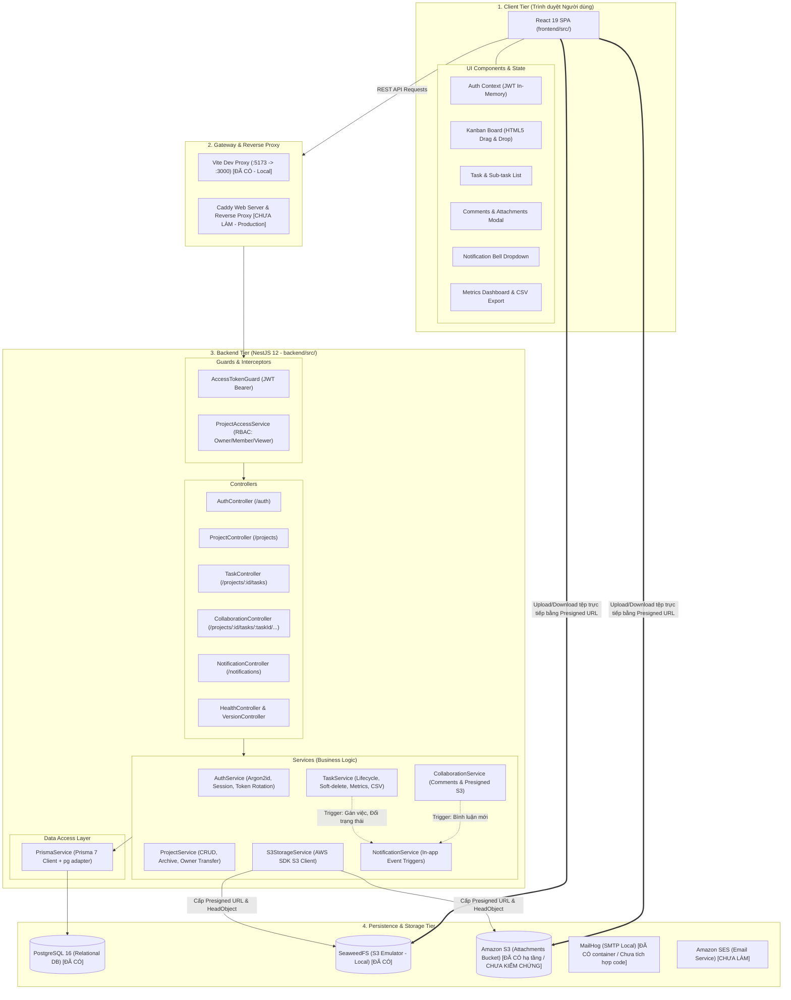

# Thiết kế Kiến trúc Hệ thống TaskFlow (System Design)

Tài liệu này mô tả chi tiết kiến trúc kỹ thuật của hệ thống TaskFlow, mô hình phân tầng, sơ đồ thành phần Mermaid, quy tắc phụ thuộc giữa các lớp mã nguồn và ma trận trạng thái hạ tầng thực tế. Nội dung được đối chiếu trực tiếp từ mã nguồn backend NestJS (`backend/src/`), frontend React (`frontend/src/`) và hạ tầng Terraform (`infra/terraform/`).

---

## 1. Kiến trúc Tổng thể & Sơ đồ Thành phần

Hệ thống TaskFlow được thiết kế theo kiến trúc phân tách Client - Server (Decoupled SPA & REST API), giao tiếp qua HTTP/JSON và tận dụng dịch vụ lưu trữ đám mây chuẩn S3-compatible để phân tải dữ liệu tệp nhị phân.

---

## 2. Quy tắc Phụ thuộc giữa các Lớp (Layer Dependency Rules)

Nhằm đảm bảo tính mở rộng, khả năng kiểm thử độc lập và tránh phụ thuộc vòng (circular dependency), mã nguồn backend NestJS tuân thủ nghiêm ngặt các quy tắc sau:

### 2.1. Chiều phụ thuộc đơn hướng (Unidirectional Flow)
- **Controller Layer $\rightarrow$ Service Layer $\rightarrow$ Data Access Layer (PrismaService)**.
- **Controllers** (`backend/src/*/*.controller.ts`):
  - Chịu trách nhiệm nhận HTTP Request, giải nén tham số qua Pipe (`ParseUUIDPipe`), xác thực dữ liệu qua DTO (`ValidationPipe`), gắn `AccessTokenGuard` và trả về HTTP Response.
  - Tuyệt đối **không gọi trực tiếp** `PrismaService` mà phải thông qua Service tương ứng.
- **Services** (`backend/src/*/*.service.ts`):
  - Chịu trách nhiệm thực thi toàn bộ logic nghiệp vụ, áp dụng transaction khi cập nhật nhiều bảng và kiểm tra quyền qua `ProjectAccessService`.
  - Không truy cập trực tiếp vào đối tượng HTTP `Request` / `Response` (ngoại trừ thao tác ghi cookie trong module `Auth`).
- **Data Access** (`backend/src/prisma/prisma.service.ts`):
  - Quản lý vòng đời kết nối tới PostgreSQL và cung cấp đối tượng client truy vấn an toàn theo kiểu (type-safe).

### 2.2. Quy tắc phụ thuộc giữa các Module Nghiệp vụ (Cross-Module Rules)
1. **Module `ProjectsModule`** (`backend/src/projects/projects.module.ts`):
   - Đóng vai trò là module nền tảng phân quyền dự án, export `ProjectAccessService`.
   - **Tuyệt đối không import** `TasksModule`, `CollaborationModule` hay `NotificationsModule`.
2. **Module `TasksModule` & `CollaborationModule`**:
   - Được phép import `ProjectsModule` (để tiêm `ProjectAccessService` phục vụ kiểm tra RBAC).
   - Được phép import `NotificationsModule` (để gọi `NotificationService.createNotification` khi phát sinh sự kiện gán task, đổi trạng thái hoặc thêm bình luận).
3. **Module `NotificationsModule`** (`backend/src/notifications/notifications.module.ts`):
   - Hoàn toàn độc lập với các module nghiệp vụ khác; chỉ import `PrismaModule` để thao tác trực tiếp với bảng `notifications`.
4. **Module `AuthModule`** (`backend/src/auth/auth.module.ts`):
   - Độc lập, chỉ import `PrismaModule` và `JwtModule`. Cung cấp `AccessTokenGuard` dùng chung toàn hệ thống.

---

## 3. Kiến trúc Chi tiết từng Module

### 3.1. Module Xác thực & Phiên (Auth & Session)
- **Cơ chế băm mật khẩu**: Sử dụng `argon2` với thuật toán Argon2id chống lại tấn công vét cạn và tấn công phần cứng chuyên dụng.
- **Mô hình phiên kép (Dual-token pattern)**:
  - Access Token: JWT có chữ ký HMAC-SHA256 (`JWT_ACCESS_SECRET`), thời hạn ngắn 15 phút, chứa payload `{ sub: userId, email }`.
  - Refresh Token: Chuỗi ngẫu nhiên sinh từ `crypto.randomBytes(32).toString('base64url')`. Ứng dụng chỉ lưu chuỗi băm **SHA-256** (64 ký tự hex) trong bảng `refresh_tokens`.
- **Cơ chế chống Replay Attack**: Khi refresh token được sử dụng, hệ thống xoay vòng tạo một token hash mới trong cùng session. Nếu một token hash đã bị thu hồi (`revokedAt != null`) được gửi lên, hệ thống thu hồi lập tức toàn bộ phiên (`auth_sessions.revokedAt = now()`).
- **Giới hạn cứng của phiên**: Cột `auth_sessions.expires_at` được cố định là thời điểm tạo + 30 ngày. Mọi thao tác làm mới token không được phép gia hạn vượt quá mốc này.

### 3.2. Module Dự án & Phân quyền RBAC (Projects & Access Control)
- **Kiểm soát truy cập dựa trên vai trò (RBAC)**:
  - Cung cấp `ProjectAccessService.requireMembership(projectId, userId)` để chặn đứng lỗ hổng IDOR (Insecure Direct Object Reference). Việc một người dùng biết UUID của một dự án không cấp quyền xem hoặc sửa dữ liệu.
  - Phương thức `ProjectAccessService.requireRole(projectId, userId, allowedRoles)` kiểm tra quyền ghi của `OWNER` và `MEMBER`.
- **Bất biến Chủ sở hữu duy nhất (Single Owner Invariant)**:
  - Mỗi dự án tại một thời điểm chỉ có đúng 1 thành viên giữ vai trò `OWNER`.
  - Việc chuyển quyền sở hữu (`POST /projects/:projectId/transfer-owner`) được bọc trong một database transaction: thăng cấp thành viên đích lên `OWNER` và hạ cấp Owner hiện tại xuống `MEMBER`.
- **Lưu trữ dự án (Project Archiving)**: Khi dự án có `archivedAt != null`, toàn bộ thao tác ghi (thêm task, bình luận, đính kèm tệp) đều bị chặn và trả về lỗi `BadRequestException`.

### 3.3. Module Công việc & Bảng kéo-thả Kanban (Tasks & Kanban)
- **Quản lý phân cấp công việc**: Hỗ trợ task cha và sub-task 1 cấp. Database bắt buộc ràng buộc khóa ngoại phức hợp `(project_id, parent_task_id) -> (project_id, id)` trên bảng `tasks`, đảm bảo task con không bao giờ bị gán nhầm sang dự án khác.
- **Xóa mềm (Soft-delete)**: Khi xóa task, backend cập nhật `deletedAt = now()`. Mặc định các truy vấn chỉ lấy các bản ghi có `deletedAt: null`. Người dùng có quyền có thể xem danh sách "Đã xóa" và gọi API khôi phục (`deletedAt = null`).
- **Giao diện Kanban trực quan**:
  - Frontend (`frontend/src/App.tsx`) chia giao diện thành 4 cột: `TODO`, `IN_PROGRESS`, `DONE`, `BLOCKED`.
  - Xử lý sự kiện kéo-thả (Drag & Drop): Khi người dùng thả thẻ task vào cột mới, giao diện lập tức dời thẻ (optimistic update) và gọi API `PATCH /projects/:projectId/tasks/:taskId` với `{ status: targetStatus }`. Nếu API báo lỗi, thẻ được trả về vị trí cũ.
  - Sub-task không hiển thị thành thẻ độc lập trên bảng Kanban mà được gom thành huy hiệu tiến độ trên thẻ của task cha.
- **Xuất dữ liệu CSV**: Endpoint `GET /projects/:projectId/tasks/export` truy vấn danh sách công việc và stream dữ liệu CSV theo chuẩn RFC 4180, bắt đầu bằng chuỗi ký tự UTF-8 BOM (`\uFEFF`) để hỗ trợ tốt nhất trên phần mềm bảng tính.

### 3.4. Module Tệp đính kèm & S3 Storage (Collaboration & Attachments)
- **Quy trình Presigned URL 3 bước**:
  1. *Khởi tạo*: Client gửi metadata qua API backend. Backend kiểm tra quyền ghi, kiểm tra dung lượng (≤ 10 MiB) và kiểm tra MIME type theo allowlist. Sau đó, backend sinh presigned PUT URL có thời hạn 5 phút với object key dạng `projects/{projectId}/tasks/{taskId}/{uuid}-{fileName}`.
  2. *Tải lên*: Client trực tiếp tải bytes dữ liệu lên S3 bucket thông qua presigned URL.
  3. *Xác thực*: Client gọi API `confirm`. Backend dùng lệnh S3 `HeadObject` để kiểm tra tệp thực sự tồn tại và có kích thước khớp với khai báo trước khi ghi nhận bản ghi `Attachment` hoàn tất (`uploadedAt = now()`).
- **Lưu trữ Local vs Production**:
  - Local dev: Sử dụng container SeaweedFS hỗ trợ đầy đủ S3 API (`http://127.0.0.1:8333`).
  - Production: Sử dụng Amazon S3 bucket được cấu hình chặn toàn bộ truy cập công khai (Block Public Access) và mã hóa AES-256 ở mức lưu trữ (SSE-S3).

### 3.5. Module Thông báo In-app (Notifications)
- **Mô hình kích hoạt sự kiện**:
  - Khi `TaskService.create` hoặc `TaskService.update` có thay đổi `assigneeId`: Tự động gọi `NotificationService.createNotification` với loại `TASK_ASSIGNED`.
  - Khi `TaskService.update` có thay đổi `status`: Tự động gửi thông báo `TASK_STATUS_CHANGED` tới người tạo task và người đang thực hiện task.
  - Khi `CollaborationService.createComment` được gọi: Tự động gửi thông báo `TASK_COMMENT_CREATED` tới người tạo task và người đang thực hiện task.
  - Nếu người thực hiện hành động chính là người nhận thông báo, hệ thống tự động bỏ qua để tránh spam (`actorId === userId`).
- **Quản lý trạng thái đọc**: API cung cấp đánh dấu đọc từng tin (`PATCH /notifications/:id/read`) hoặc đánh dấu đọc toàn bộ (`POST /notifications/read-all`) cập nhật trường `is_read = true` và `read_at = now()`.

---

## 4. Hiện trạng Hạ tầng & Triển khai

Dưới đây là ma trận trạng thái các thành phần hạ tầng và dịch vụ của hệ thống:

| Thành phần | Môi trường | Trạng thái | Chi tiết triển khai & Ghi chú |
|---|---|---|---|
| **PostgreSQL 16** | Local | **[ĐÃ CÓ]** | Chạy trong Docker Compose (`compose.yaml`), lưu volume `pgdata`. |
| **PostgreSQL 16** | Production | **[ĐÃ CÓ]** | Container chạy trên EC2, dữ liệu lưu trên EBS gp3 20 GiB mã hóa riêng biệt. |
| **Backend API (NestJS 12)** | Local | **[ĐÃ CÓ]** | Chạy qua Docker Compose hoặc Node.js trực tiếp trên host. |
| **Backend API (NestJS 12)** | Production | **[ĐÃ CÓ]** | Multi-stage Dockerfile, build và scan Trivy trên CI, triển khai lên EC2 qua SSM. |
| **Frontend SPA (React 19)** | Local | **[ĐÃ CÓ]** | Chạy qua Vite Dev Server (`:5173`), dev proxy API về `:3000`. |
| **Frontend SPA (React 19)** | Production | **[CHƯA LÀM]** | Hướng đã chọn: Caddy trong Compose phục vụ static build trên EC2 (ADR-001). |
| **Object Storage (S3)** | Local | **[ĐÃ CÓ]** | SeaweedFS S3 emulator chạy trên Docker Compose (`:8333`). |
| **Object Storage (S3)** | Production | **[ĐÃ CÓ hạ tầng]** / **[CHƯA KIỂM CHỨNG tích hợp]** | S3 bucket riêng tư đã tạo bằng Terraform; cần kiểm thử end-to-end qua ứng dụng sau release đầu tiên. |
| **Caddy Web Server & Reverse Proxy** | Production | **[CHƯA LÀM]** | Dự kiến chạy trong Compose trên EC2 làm reverse proxy `/api` và cấp HTTPS tự động. |
| **Tên miền & Chứng chỉ HTTPS** | Production | **[CHƯA LÀM]** | Hiện API bind loopback trên EC2, chưa có domain công khai và SSL certificate. |
| **Hạ tầng AWS bằng Terraform** | Production | **[ĐÃ CÓ]** | Quản lý VPC, Subnet, Security Group, EC2 `t3.small`, EBS mã hóa, ECR, S3, IAM OIDC. |
| **CI/CD Pipeline (GitHub Actions)** | CI | **[ĐÃ CÓ]** | Workflow `ci.yml` (test, e2e, scan Trivy) và `cd.yml` (OIDC, ECR push, SSM deploy). |
| **Quản lý Secrets (SSM Parameter Store)** | Production | **[ĐÃ CÓ]** | Lưu trữ `SecureString` cho database credentials và JWT signing secret. |
| **Dịch vụ Email (MailHog)** | Local | **[ĐÃ CÓ container]** / **[CHƯA LÀM tích hợp]** | MailHog có trong `compose.yaml`; backend chưa có `MailModule`. |
| **Dịch vụ Email (AWS SES)** | Production | **[CHƯA LÀM]** | Chưa cấu hình SES identity và chưa tích hợp SDK gửi thư. |
| **Tự động sao lưu Database lên S3** | Production | **[CHƯA LÀM]** | S3 backup bucket đã có; chưa có cron job `pg_dump` và diễn tập khôi phục. |
| **Giám sát & Cảnh báo (Monitoring)** | Production | **[CHƯA LÀM]** | Chưa expose endpoint Prometheus `/metrics` và chưa cấu hình CloudWatch Alarms. |

---

## 5. Tài liệu Liên quan

- [Mục lục Tài liệu](../README.md)
- [Trạng thái Hệ thống](../STATE.md)
- [Tổng quan Sản phẩm](../overview/product-overview.md)
- [Yêu cầu Hệ thống](../overview/requirements.md)
- [Thiết kế Cơ sở Dữ liệu](database.md)
- [Quyết định Kiến trúc (ADR)](decisions.md)
- [Vấn đề Tồn đọng & Điểm lệch Kỹ thuật](../project/known-issues.md)
- [Lộ trình Phát triển](../project/roadmap.md)
- [Hướng dẫn Triển khai Production](../../deploy/README.md)
- [Hạ tầng AWS bằng Terraform](../../infra/terraform/README.md)
