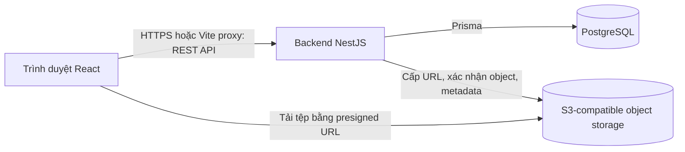

# Tài liệu thiết kế kỹ thuật TaskFlow

## 1. Mục đích và trạng thái

Tài liệu mô tả kiến trúc và các quyết định kỹ thuật của MVP TaskFlow. Đây là
tài liệu thiết kế dựa trên mã nguồn hiện tại, không phải xác nhận rằng mọi
thành phần đã được triển khai hoặc kiểm chứng trên production.

Backend NestJS đã được triển khai trên EC2. Frontend React hiện chạy ở môi
trường local. Các API collaboration, dashboard và CSV có trong mã nguồn; việc
xác minh luồng object storage thực tế và phát hành các chức năng này trên
production vẫn cần được thực hiện.

## 2. Kiến trúc tổng thể

### 2.1. Thành phần

| Thành phần | Công nghệ | Trách nhiệm |
|---|---|---|
| Frontend | React, TypeScript, Vite | Giao diện đăng nhập, dự án, thành viên, task/sub-task, bình luận, tệp đính kèm, dashboard và CSV |
| Backend | NestJS, TypeScript | REST API, xác thực, phân quyền, quy tắc nghiệp vụ, tích hợp object storage |
| ORM và migration | Prisma 7 | Truy cập PostgreSQL, sinh client và quản lý schema theo migration |
| Database | PostgreSQL 16 | Tài khoản, phiên, dự án, membership, task, bình luận và metadata tệp |
| Object storage | SeaweedFS S3 API local; Amazon S3 dự kiến cho production | Lưu bytes của tệp đính kèm; bucket production phải riêng tư |
| Local development | Docker Compose | Chạy PostgreSQL, API, SeaweedFS và MailHog |
| Production delivery | Terraform, ECR, EC2, SSM, GitHub Actions OIDC | Cung cấp hạ tầng, lưu image và triển khai backend |

### 2.2. Module backend

- `auth`: đăng ký, đăng nhập, refresh, logout và hồ sơ người dùng.
- `projects`: quản lý dự án, thành viên, vai trò, metrics và chuyển quyền Owner.
- `tasks`: task/sub-task, lọc, soft-delete/restore và xuất CSV.
- `collaboration`: bình luận và luồng upload/download tệp đính kèm.
- `prisma`: kết nối database và Prisma client.
- `health`, `version`: readiness/liveness và thông tin build.

## 3. Mô hình dữ liệu

- `users`: tài khoản, email chuẩn hóa và password hash.
- `auth_sessions`, `refresh_tokens`: phiên đăng nhập, thời điểm hết hạn/thu hồi
  và hash refresh token.
- `projects`, `project_members`: dự án cùng membership/role; mỗi dự án có một
  Owner hiện hành.
- `tasks`: task và sub-task, người tạo/người được giao, trạng thái, ưu tiên,
  hạn hoàn thành và thời điểm soft-delete.
- `task_comments`: nội dung bình luận và tác giả.
- `attachments`: metadata tệp, object key và thời điểm upload hoàn tất; bytes
  không được lưu trong PostgreSQL.

Quan hệ và chi tiết cột được mô tả trong [thiết kế cơ sở dữ liệu](database.md).
Thông báo, quy tắc lặp và feature flags là các khả năng tương lai, không phải
bảng/chức năng đã có trong MVP.

## 4. Quy tắc nghiệp vụ và quyền truy cập

### 4.1. Vai trò

| Quyền | Owner | Member | Viewer |
|---|---:|---:|---:|
| Đọc dữ liệu dự án, task, metrics và CSV | Có | Có | Có |
| Sửa thông tin dự án, quản lý thành viên, chuyển quyền Owner | Có | Không | Không |
| Tạo/sửa/xóa mềm/khôi phục task | Có | Có | Không |
| Đọc bình luận | Có | Có | Có |
| Tạo bình luận và upload/download tệp | Có | Có | Không |
| Quản lý bình luận hoặc tệp của thành viên khác | Có | Không | Không |

Mọi API nghiệp vụ phải kiểm tra membership trên đúng project ID. Việc biết
UUID không cấp quyền truy cập. Dự án đã archive chỉ đọc; Viewer không được
thay đổi task. Quyền chi tiết được quy định trong
[yêu cầu sản phẩm](../overview/requirements.md).

### 4.2. Task

- Trạng thái: `TODO`, `IN_PROGRESS`, `DONE`, `BLOCKED`.
- Mức ưu tiên: `LOW`, `MEDIUM`, `HIGH`, `URGENT`.
- Sub-task tối đa một cấp và phải tham chiếu task cha còn hoạt động trong cùng
  dự án.
- Xóa task là soft-delete. Khôi phục chỉ áp dụng cho Owner và Member.
- Task được giao phải thuộc cùng dự án với assignee.

## 5. Các luồng kỹ thuật chính

### 5.1. Đăng nhập và duy trì phiên

1. Người dùng gửi thông tin đăng nhập qua `POST /auth/login` hoặc tạo tài khoản
   qua `POST /auth/register`.
2. Backend kiểm tra mật khẩu Argon2id, tạo auth session và trả access JWT
   trong response; refresh token được gửi bằng cookie HttpOnly.
3. Frontend chỉ giữ access token trong bộ nhớ. Khi API trả 401, client thử
   `POST /auth/refresh` rồi gửi lại request tối đa một lần.
4. Mỗi lần refresh hợp lệ, backend thu hồi refresh token cũ và tạo token mới
   trong transaction. Replay token đã dùng sẽ thu hồi phiên.
5. Access JWT hết hạn sau **15 phút**. Auth session hết hạn tuyệt đối sau
   **30 ngày** kể từ lúc tạo; refresh không gia hạn giới hạn này.
6. Logout thu hồi phiên và xóa cookie refresh.

### 5.2. Upload và download tệp

1. Owner hoặc Member yêu cầu tạo attachment thông qua backend.
2. Backend kiểm tra membership, task còn hoạt động, kích thước tối đa **10 MiB**
   và MIME type thuộc allowlist cấu hình; backend tạo metadata cùng object key
   ngẫu nhiên và trả presigned URL.
3. Trình duyệt tải nội dung trực tiếp lên object storage. Presigned URL có hiệu
   lực **5 phút**.
4. Trình duyệt gọi endpoint hoàn tất. Backend xác minh object trong storage
   trước khi đánh dấu attachment đã upload.
5. Backend chỉ cấp presigned download URL cho attachment đã hoàn tất và người
   dùng có quyền trong dự án. Xóa attachment tuân theo vai trò và quyền sở hữu.

### 5.3. Thống kê và CSV

- Dashboard gọi API metrics theo project; backend tính toán dữ liệu từ task,
  membership, bình luận và metadata attachment.
- API export trả CSV UTF-8 có BOM để tăng khả năng tương thích với phần mềm
  bảng tính.
- Hai chức năng này có trong mã nguồn hiện tại; cần xem trạng thái triển khai
  tại [trạng thái hệ thống](../STATE.md).

## 6. API và xử lý lỗi

- API nghiệp vụ yêu cầu access JWT dạng Bearer, ngoại trừ các route đăng ký,
  đăng nhập, refresh, logout và health/version được công bố riêng.
- DTO được dùng để kiểm tra dữ liệu đầu vào; UUID route parameters được parse
  trước khi gọi service.
- Service thực thi authorization theo membership và vai trò, không dựa riêng
  vào việc ẩn nút trên frontend.
- API trả lỗi HTTP phù hợp khi không xác thực, không có quyền, dữ liệu sai
  hoặc tài nguyên không tồn tại.

Các endpoint chính được liệt kê trong [README gốc](../../README.md).

## 7. Môi trường và phát hành

### 7.1. Local

- Docker Compose chạy PostgreSQL, backend API, SeaweedFS và MailHog.
- SeaweedFS cung cấp S3 API cho phát triển; frontend Vite proxy API cùng origin.
- Prisma migration được áp dụng bằng lệnh phát triển hoặc quy trình release
  tương ứng; không reset dữ liệu để phát hành migration.

### 7.2. Production

- GitHub Actions dùng OIDC để đẩy image vào ECR và gửi lệnh triển khai qua SSM.
- EC2 chạy API và PostgreSQL; PostgreSQL không publish ra Internet. API hiện
  bind localhost trên EC2, chưa có reverse proxy/HTTPS công khai.
- Runtime secrets lấy từ SSM Parameter Store; EC2 dùng IAM role thay vì AWS
  access key tĩnh.
- Deploy chạy Prisma migration trước khi thay API image. Rollback image không
  tự rollback database schema.
- Frontend production, domain/HTTPS, backup/restore đã diễn tập và monitoring/
  cảnh báo vẫn là hạng mục cần hoàn thiện.

Chi tiết thao tác nằm trong [tài liệu triển khai](../../deploy/README.md) và
[tài liệu Terraform](../../infra/terraform/README.md).

## 8. Các ràng buộc bảo mật

- Password hash dùng Argon2id; refresh token chỉ lưu dưới dạng SHA-256 hash.
- Cookie refresh đặt `HttpOnly`, `SameSite=Lax`; trong production bật `Secure`.
- Bucket object storage phải riêng tư; truy cập tệp thông qua presigned URL
  giới hạn thời gian.
- Không ghi token, credential hoặc nội dung secret vào log/tài liệu.
- Phân quyền project-scoped phải được kiểm thử, bao gồm trường hợp truy cập
  chéo dự án và role Viewer.

## 9. Tài liệu liên quan

- [README dự án](../../README.md)
- [Yêu cầu sản phẩm](../overview/requirements.md)
- [Chức năng và luồng nghiệp vụ](../overview/product-overview.md)
- [Thiết kế cơ sở dữ liệu](database.md)
- [Trạng thái hệ thống](../STATE.md)
- [Báo cáo tiến độ & lộ trình](../project/progress.md)
