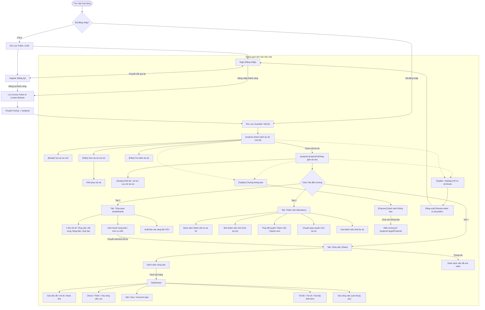

# Sơ đồ Luồng Điều hướng UI/UX (UI/UX Navigation Flow) — TaskFlow

Tài liệu này đặc tả toàn bộ kiến trúc điều hướng (Navigation Architecture), luồng hành trình người dùng (User Journey Flows), sơ đồ chuyển đổi trạng thái (State Transitions), và mối quan hệ giữa các Route, Component và quyền hạn (RBAC) trong ứng dụng **TaskFlow**.

---

## 1. Sơ đồ Luồng Điều hướng Tổng thể (Global Navigation Flow)

---

## 2. Bảng ánh xạ Route, Component và Quyền truy cập (RBAC Matrix)

| URL Route | Tên màn hình / Chức năng | Component File | Quyền truy cập (Role) | Chuyển hướng khi vi phạm |
| :--- | :--- | :--- | :--- | :--- |
| `/login` | Đăng nhập hệ thống | `frontend/src/pages/AuthPage.tsx` | Khách (Public only) | Nếu đã đăng nhập $\rightarrow$ `/projects` |
| `/register` | Đăng ký tài khoản | `frontend/src/pages/AuthPage.tsx` | Khách (Public only) | Nếu đã đăng nhập $\rightarrow$ `/projects` |
| `/projects` | Danh sách dự án | `frontend/src/pages/ProjectsPage.tsx` | Đã xác thực (Guarded) | Nếu chưa đăng nhập $\rightarrow$ `/login` |
| `/projects/:projectId` | Không gian làm việc dự án | `frontend/src/pages/WorkspacePage.tsx` | Thành viên dự án (`OWNER`, `MEMBER`, `VIEWER`) | Nếu không thuộc dự án $\rightarrow$ Báo lỗi / `/projects` |
| `*` | Tuyến đường không hợp lệ | Fallback Router | Mọi đối tượng | Tự động chuyển hướng $\rightarrow$ `/projects` |

---

## 3. Luồng Chi tiết theo Từng Màn hình (Detailed User Journeys)

### 3.1. Luồng Xác thực (Authentication Journey)
1. **Truy cập ban đầu**: Trình duyệt kiểm tra phiên qua `authApi.refresh()`:
   - Nếu có phiên hợp lệ: Tự động lưu `accessToken` trong bộ nhớ và chuyển vào `/projects`.
   - Nếu không có: Hiển thị form đăng nhập tại `/login`.
2. **Tại `/login`**: Người dùng nhập Email và Mật khẩu. Có nút ẩn/hiện mật khẩu và chuyển nhanh sang `/register`.
3. **Tại `/register`**: Bổ sung trường "Tên hiển thị". Mật khẩu yêu cầu tối thiểu 12 ký tự để đảm bảo chuẩn an toàn SaaS.
4. **Xử lý lỗi**: Mọi thông báo lỗi từ backend (sai thông tin, email trùng, hết phiên) được hiển thị trực tiếp trong banner thông báo chuẩn accessibility (`role="alert"`).

### 3.2. Luồng Quản lý Dự án (`/projects`)
1. **Xem dự án hoạt động**: Hiển thị lưới card các dự án mà người dùng đang tham gia với đầy đủ Monogram, Tên, Mô tả, Vai trò (`Chủ dự án`, `Thành viên`, `Người xem`) và ngày tạo.
2. **Tìm kiếm thời gian thực (Instant Search)**: Ô input tìm kiếm ở toolbar lọc danh sách ngay khi gõ mà không cần reload trang.
3. **Tạo dự án mới**: Người dùng có thể nhấn vào card "＋ Tạo dự án mới" hoặc nút ở góc phải. Modal dialog xuất hiện cho phép nhập tên dự án (tối đa 120 ký tự) và mô tả.
4. **Xem & Khôi phục dự án đã lưu trữ**: Bật toggle "Hiện dự án đã lưu trữ" sẽ chuyển danh sách sang các dự án đã archive. Nhấn "Khôi phục dự án" để đưa dự án hoạt động trở lại.

### 3.3. Luồng Không gian làm việc (`/projects/:projectId`)
Màn hình trung tâm của TaskFlow được tổ chức thành 3 Tab chức năng:

#### Tab 1: Công việc (Tasks)
- **Danh sách công việc**:
  - Hiển thị các cột: Trạng thái, Tiêu đề, Mức độ ưu tiên, Người phụ trách, Hạn chót.
- **Thùng rác (Deleted Tasks)**:
  - Bật toggle "Thùng rác" để xem các công việc đã bị xóa mềm và thực hiện "Khôi phục" chỉ với 1 click.
- **Bộ lọc & Xuất CSV**:
  - Lọc theo Trạng thái hoặc Mức ưu tiên độc lập.
  - Nút **Xuất CSV** tải xuống ngay file `taskflow-[ten-du-an]-[ngay].csv` đúng theo bộ lọc đang chọn.
- **Thanh trượt chi tiết công việc (Task Details Drawer)**:
  - Click vào bất kỳ công việc nào trong danh sách sẽ mở Drawer trượt mượt mà từ cạnh phải màn hình.
  - Cho phép chỉnh sửa tiêu đề, mô tả, thay đổi trạng thái, mức ưu tiên, phân công người làm, hạn chót.
  - **Quản lý việc con (Subtasks)**: Đánh dấu hoàn thành, xem thanh tiến độ %, thêm việc con mới, click vào việc con để mở chi tiết sâu hơn.
  - **Bình luận (Comments)**: Dòng thời gian thảo luận của nhóm, cho phép người viết hoặc chủ dự án sửa/xóa bình luận.
  - **Tệp đính kèm (Attachments)**: Tải file lên (tối đa 10 MiB), tải về qua S3 Presigned URL, xóa tệp với hộp thoại xác nhận.

#### Tab 2: Báo cáo & Phân tích (Dashboard)
- 4 thẻ KPI nổi bật: **Tổng số việc**, **Đã hoàn thành (% tỷ lệ)**, **Đang thực hiện**, **Quá hạn**.
- Thanh tiến độ tổng thể trực quan với cảnh báo công việc đang bị chặn (nếu có).
- **Phân bố Trạng thái & Mức ưu tiên tương tác (Interactive Filtering)**: Khi người dùng nhấp vào bất kỳ thanh trạng thái nào (ví dụ: *Bị chặn* hoặc *Khẩn cấp*), hệ thống sẽ tự động chuyển sang Tab Công việc và áp dụng bộ lọc tương ứng.
- **Bảng tải công việc theo thành viên (Team Workload)**: Thống kê chi tiết từng người được giao bao nhiêu việc, đã hoàn thành bao nhiêu, quá hạn bao nhiêu và thanh % tiến độ cá nhân.
- Thống kê tổng bình luận và tệp đính kèm toàn dự án.

#### Tab 3: Quản lý Thành viên (Members)
- Danh sách thành viên tham gia kèm nhãn vai trò và nhãn "(Bạn)".
- **Chỉ dành cho Chủ dự án (OWNER)**:
  - Form mời thành viên mới bằng email và chọn vai trò khởi đầu (`MEMBER` hoặc `VIEWER`).
  - Dropdown đổi vai trò trực tiếp giữa `Thành viên` và `Người xem`.
  - Nút **Chuyển quyền Chủ dự án** kèm modal cảnh báo xác nhận.
  - Nút **Xóa khỏi dự án** kèm modal cảnh báo xác nhận.

### 3.4. Luồng Thông báo (In-App Notification Journey)
- Chuông thông báo ở góc phải TopBar tự động kiểm tra định kỳ (polling mỗi 20s).
- Khi có thông báo mới (được giao việc, đổi trạng thái, có bình luận mới, việc sắp tới hạn), badge đếm số lượng thông báo chưa đọc sẽ hiển thị.
- Nhấp vào chuông sẽ mở Popover thông báo chia theo 2 tab: "Tất cả" và "Chưa đọc".
- Người dùng có thể đánh dấu từng thông báo đã đọc (`✓`) hoặc nhấn "Đánh dấu tất cả đã đọc".
- Nhấp vào nội dung thông báo sẽ tự động đánh dấu đã đọc và điều hướng thẳng đến Không gian dự án liên quan.
