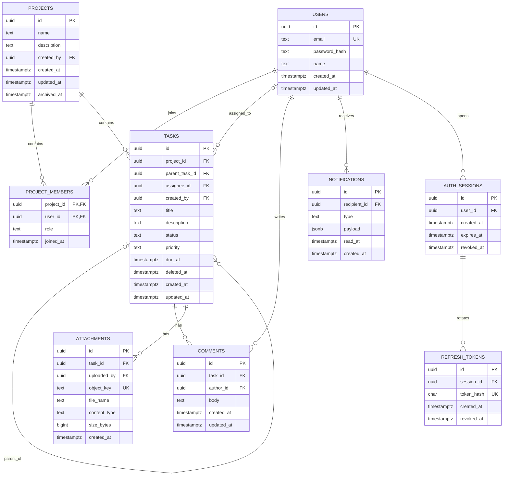

# Thiết kế cơ sở dữ liệu TaskFlow

- Trạng thái: Schema MVP đã được cập nhật; migration mới đã áp dụng trên local, chưa phát hành lên production.
- Database: PostgreSQL 16
- ORM/migration: Prisma 7

## ERD dự kiến

## Mô hình cho mốc backend đầu tiên

### `users`

- UUID primary key.
- Email được trim và chuyển lowercase ở application boundary trước khi persist; unique constraint hiện tại ngăn trùng trên giá trị canonical. Không thêm PostgreSQL extension.
- Lưu `password_hash`, không lưu mật khẩu; `display_name` và UTC timestamps.
- Tài khoản được tham chiếu bởi membership, task assignee/creator và các dữ liệu tương lai.

### `projects`

- UUID primary key, tên, mô tả tùy chọn, creator và UTC timestamps.
- Thành viên và vai trò lưu trong `project_members`, không lưu danh sách user trong JSON.
- Dự án được archive/khôi phục bằng `archived_at`; không xóa dây chuyền dữ liệu khi archive.

### `project_members`

- Khóa ghép `(project_id, user_id)` để mỗi người chỉ có một membership trong một dự án.
- `role` là enum Owner/Member/Viewer.
- Mỗi dự án có đúng một Owner hiện hành (đã duyệt); partial unique index được thêm bằng SQL trong migration vì Prisma không biểu diễn trực tiếp kiểu index này.
- Không xóa Owner cuối cùng hoặc chuyển Owner nếu không có bước chuyển quyền trong cùng transaction.

### `tasks`

- Thuộc một Project; `parent_task_id` null cho task gốc, có giá trị cho sub-task.
- Enum trạng thái `TODO`, `IN_PROGRESS`, `DONE`, `BLOCKED` và ưu tiên `LOW`, `MEDIUM`, `HIGH`, `URGENT` đã được duyệt.
- `assignee_id` có thể null. Assignee bắt buộc phải là thành viên của cùng project; service phải xác minh và e2e test invariant này. Có thể bổ sung composite foreign key/trigger nếu cần bảo đảm ở tầng DB.
- Sub-task phải cùng project với task cha và giới hạn một cấp (đã duyệt).
- Index dự kiến: `(project_id, status)`, `(project_id, due_at)`, `(assignee_id, status)`, `(parent_task_id)`.
- Task được soft-delete/khôi phục qua `deleted_at`; comments/attachments tương lai được giữ lại và không hiển thị khi task đã xóa.

### `auth_sessions` và `refresh_tokens`

- Mỗi lần đăng nhập tạo auth session với thời hạn tuyệt đối 30 ngày; refresh không gia hạn mốc hết hạn này.
- Access token là JWT 15 phút. Refresh token là giá trị ngẫu nhiên; chỉ SHA-256 hash được lưu trong database.
- Mỗi refresh thu hồi token cũ và tạo token mới trong transaction; phát hiện token đã dùng lại sẽ thu hồi cả session.
- Logout thu hồi session; access-token guard kiểm tra session còn hoạt động nên logout có hiệu lực ngay với cả access JWT. Refresh token được gửi qua cookie `HttpOnly`, `SameSite=Lax`, `Secure` trong production; access token trả về response và client chỉ giữ trong bộ nhớ.
- Email verification được hoãn; email chưa xác minh vẫn có thể đăng nhập trong MVP.

## Mô hình cho các mốc tiếp theo

- `comments`: tham chiếu task và tác giả; quyền đọc/ghi theo membership dự án. Chính sách sửa/xóa bình luận cần chốt.
- `attachments`: chỉ lưu metadata và S3 object key; không lưu nội dung tệp trong PostgreSQL. Presigned URL ngắn hạn được tạo sau khi kiểm tra quyền.
- `notifications`: notification trong ứng dụng; email delivery cần cơ chế retry/outbox hoặc queue riêng để tránh gửi email trong transaction nghiệp vụ.
- `recurrence_rules`/`task_occurrences`: chưa chọn lưu quy tắc RRULE hay cấu hình có cấu trúc; cần quyết định timezone và hành vi khi tháng thiếu ngày đích.
- `feature_flags`: cần xác định flag theo toàn hệ thống, người dùng hay dự án; không dùng flag thay thế authorization.

## Ràng buộc xuyên suốt

- Foreign keys và unique constraints cho quan hệ định danh; index trên các cột lọc/sắp xếp phổ biến.
- Dùng transaction cho tạo project kèm Owner membership, chuyển Owner, và cập nhật membership/assignee.
- API bắt buộc kiểm tra project membership trên mọi truy vấn đọc/ghi để chống IDOR; không chỉ dựa vào UUID khó đoán.
- Không cascade delete dữ liệu dự án; archive dự án và soft-delete task để giữ khả năng khôi phục.
- Dùng UTC `timestamptz`; quy đổi timezone ở giao diện theo lựa chọn người dùng.
- Mỗi thay đổi production phải có migration tương thích; deploy hiện chạy `prisma migrate deploy`, không tự rollback schema.

## Trước các migration tiếp theo

Các quyết định còn mở được liệt kê trong [yêu cầu sản phẩm](./requirements.md). Ma trận quyền cơ sở, một Owner, bộ trạng thái/ưu tiên, sub-task một cấp, archive dự án, soft-delete task và chính sách access/refresh token đã được duyệt. Migration `application_core` và `auth_sessions` đã được áp dụng trên local; production hiện vẫn ở migration khởi tạo User. Không sửa migration cũ hoặc reset volume. Mọi thay đổi tiếp theo phải đi qua migration mới theo hướng mở rộng/an toàn dữ liệu.
