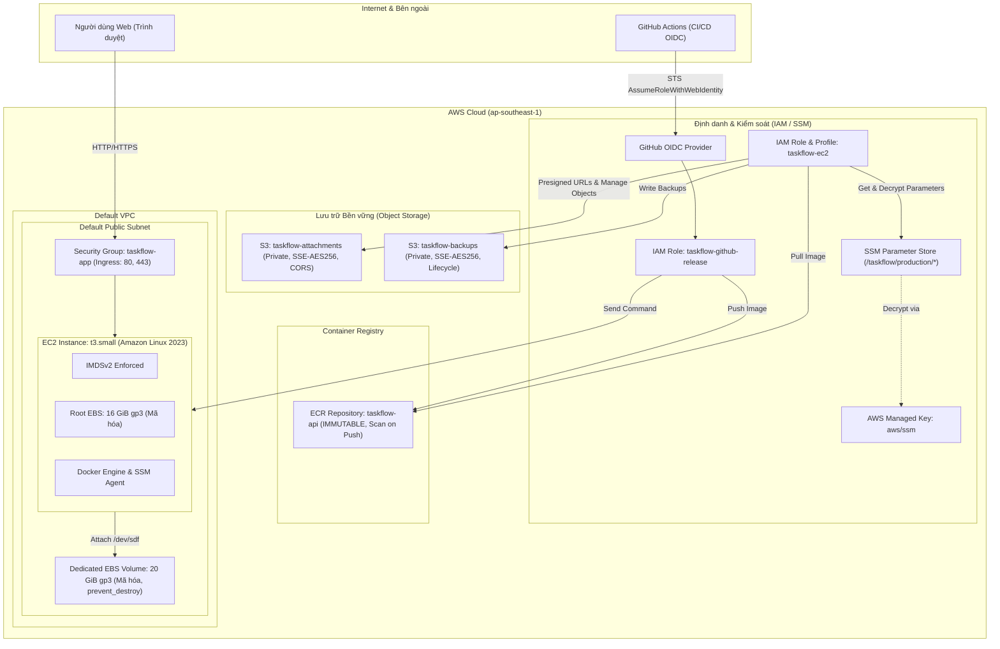

# Tổng quan Hạ tầng AWS (AWS Infrastructure & Terraform)

Tài liệu này đặc tả toàn bộ kiến trúc hạ tầng đám mây trên **Amazon Web Services (AWS)** của dự án **TaskFlow**, được quản trị hoàn toàn dưới dạng mã nguồn (Infrastructure as Code - IaC) bằng **HashiCorp Terraform**.

---

## 1. Sơ đồ Kiến trúc Hạ tầng Tổng thể

Toàn bộ tài nguyên được khởi tạo tại AWS Region **`ap-southeast-1`** (Singapore), tuân thủ nguyên tắc tối ưu hóa chi phí (Cost Efficiency), bảo mật nhiều lớp và độ tin cậy cao:



---

## 2. Khởi tạo Trạng thái Terraform Bootstrap (`infra/bootstrap/`)

Để đảm bảo việc phối hợp nhóm an toàn, trạng thái Terraform (Terraform State) không lưu trữ trên máy cá nhân mà được lưu trữ từ xa (Remote State) trên AWS S3 kết hợp khóa trạng thái (State Locking) bằng Amazon DynamoDB.

### 2.1. Cấu hình Thư mục `infra/bootstrap/`
Thư mục [`infra/bootstrap/`](../../infra/bootstrap/) bao gồm các tệp cấu hình tạo nền móng ban đầu:
- **`main.tf`**:
  - `aws_s3_bucket.terraform_state`: Tạo S3 bucket `taskflow-terraform-state-<account-id>-<region>`.
    - Kích hoạt cơ chế lưu phiên bản (`aws_s3_bucket_versioning`).
    - Kích hoạt mã hóa mặc định AES256 (`aws_s3_bucket_server_side_encryption_configuration`).
    - Chặn toàn bộ truy cập công khai (`aws_s3_bucket_public_access_block`).
    - Chính sách TLS Policy: Từ chối các yêu cầu không mã hóa HTTPS (`aws:SecureTransport = false`).
  - `aws_dynamodb_table.terraform_locks`: Bảng DynamoDB `taskflow-terraform-locks` với chế độ thanh toán `PAY_PER_REQUEST` (On-Demand), sử dụng khóa chính `LockID` (String) để khóa state khi chạy lệnh `apply`.

### 2.2. Khởi tạo Backend Configuration (`infra/terraform/backend.hcl`)
Sau khi chạy apply thành công thư mục `bootstrap`, tạo tệp [`infra/terraform/backend.hcl`](../../infra/terraform/backend.hcl) (mẫu tại `backend.hcl.example`):
```hcl
bucket         = "taskflow-terraform-state-<account-id>-ap-southeast-1"
key            = "production/terraform.tfstate"
region         = "ap-southeast-1"
dynamodb_table = "taskflow-terraform-locks"
encrypt        = true
```

---

## 3. Danh mục Toàn bộ Tài nguyên Hạ tầng (`infra/terraform/`)

Mã nguồn trong [`infra/terraform/main.tf`](../../infra/terraform/main.tf) quản lý tổng cộng **26 tài nguyên** AWS:

| Nhóm chức năng | Tên tài nguyên Terraform | Loại tài nguyên AWS | Mô tả & Ràng buộc bảo mật |
|---|---|---|---|
| **Identity & OIDC** | `aws_iam_openid_connect_provider.github_actions` | IAM OIDC Provider | Kết nối OIDC GitHub Actions (`token.actions.githubusercontent.com`) |
| **CI/CD Role** | `aws_iam_role.github_actions_release` | IAM Role | Role nhận quyền tạm thời từ GitHub Actions |
| **CI/CD Policy** | `aws_iam_role_policy.github_actions_release` | IAM Role Policy | Cấp quyền ECR push và gửi SSM SendCommand tới EC2 |
| **EC2 Role** | `aws_iam_role.ec2` | IAM Role | Service role cho máy chủ EC2 |
| **EC2 Policy Core** | `aws_iam_role_policy_attachment.ec2_ssm` | Policy Attachment | Gắn policy chuẩn `AmazonSSMManagedInstanceCore` |
| **EC2 Policy App** | `aws_iam_role_policy.ec2_runtime` | IAM Role Policy | Cấp quyền ECR pull, S3 attachments/backups, SSM Parameter decrypt |
| **EC2 Profile** | `aws_iam_instance_profile.ec2` | Instance Profile | Gắn Role `taskflow-ec2` vào máy chủ EC2 |
| **Network Security** | `aws_security_group.app` | Security Group | Ingress: 80, 443; Egress: All. Không mở cổng 22 (SSH) hay 5432 (DB) |
| **Container Registry**| `aws_ecr_repository.api` | ECR Repository | Lưu image Docker với `tag_mutability = IMMUTABLE`, scan on push, AES256 |
| **ECR Lifecycle** | `aws_ecr_lifecycle_policy.api` | ECR Lifecycle Policy| Giữ tối đa 10 image mới nhất phục vụ rollback |
| **Object Storage** | `aws_s3_bucket.attachments` | S3 Bucket | Lưu trữ tệp đính kèm người dùng tải lên |
| **S3 Public Block** | `aws_s3_bucket_public_access_block.attachments` | S3 Block Public Access | Chặn 100% truy cập công khai (4 flags = true) |
| **S3 Encryption** | `aws_s3_bucket_server_side_encryption_configuration.attachments` | S3 Encryption | Mã hóa AES256 tự động ở mức lưu trữ |
| **S3 Versioning** | `aws_s3_bucket_versioning.attachments` | S3 Versioning | Kích hoạt lưu trữ lịch sử phiên bản tệp |
| **S3 Lifecycle** | `aws_s3_bucket_lifecycle_configuration.attachments` | S3 Lifecycle Policy | Xóa noncurrent version sau 30 ngày, hủy multipart sau 7 ngày |
| **S3 TLS Enforce** | `aws_s3_bucket_policy.attachments_tls` | S3 Bucket Policy | Deny mọi request nếu không dùng HTTPS (`aws:SecureTransport = false`) |
| **S3 CORS** | `aws_s3_bucket_cors_configuration.attachments` | S3 CORS | Cấu hình CORS cho presigned upload (GET, PUT, HEAD; expose ETag) |
| **Backup Storage** | `aws_s3_bucket.backups` | S3 Bucket | Lưu trữ các bản sao lưu cơ sở dữ liệu PostgreSQL |
| **S3 Public Block** | `aws_s3_bucket_public_access_block.backups` | S3 Block Public Access | Chặn 100% truy cập công khai (4 flags = true) |
| **S3 Encryption** | `aws_s3_bucket_server_side_encryption_configuration.backups` | S3 Encryption | Mã hóa AES256 tự động ở mức lưu trữ |
| **S3 Versioning** | `aws_s3_bucket_versioning.backups` | S3 Versioning | Kích hoạt lưu trữ lịch sử phiên bản backup |
| **S3 Lifecycle** | `aws_s3_bucket_lifecycle_configuration.backups` | S3 Lifecycle Policy | Hết hạn bản sao lưu sau `var.backup_retention_days` (14 ngày) |
| **S3 TLS Enforce** | `aws_s3_bucket_policy.backups_tls` | S3 Bucket Policy | Deny mọi request nếu không dùng HTTPS (`aws:SecureTransport = false`) |
| **Configuration** | `aws_ssm_parameter.attachments_bucket` | SSM Parameter | Lưu tên S3 bucket attachments vào `/taskflow/production/attachments-bucket` |
| **Database Storage**| `aws_ebs_volume.postgres` | EBS Volume (gp3) | Ổ cứng 20 GiB gp3 riêng biệt, mã hóa AES256, bật `prevent_destroy` |
| **Compute Engine** | `aws_instance.app` | EC2 Instance | Máy chủ `t3.small`, chạy Amazon Linux 2023, bắt buộc IMDSv2 |
| **Storage Attach** | `aws_volume_attachment.postgres` | EBS Attachment | Gắn ổ đĩa dữ liệu vào EC2 tại `/dev/sdf` |

---

## 4. Chi tiết Kỹ thuật Từng Khối Thành phần

### 4.1. Khối Mạng (Networking)
- Tận dụng **Default VPC** và Subnet công khai có sẵn để tối giản chi phí NAT Gateway (~$32/tháng).
- **Security Group (`taskflow-app`)**:
  - `Ingress 80`: Cho phép toàn cầu (`0.0.0.0/0`) phục vụ kiểm tra chứng chỉ Let's Encrypt (ACME HTTP-01) và điều hướng (redirect) sang HTTPS.
  - `Ingress 443`: Cho phép toàn cầu (`0.0.0.0/0`) đón lưu lượng HTTPS an toàn.
  - `Egress All`: Cho phép kết nối ra ngoài để cập nhật hệ điều hành, kéo container từ ECR và giao tiếp với AWS APIs (SSM, S3).
  - Không có luật mở cổng 22 (SSH) hay 5432 (Postgres).

### 4.2. Khối Điện toán Máy chủ (EC2 Compute & Operating System)
- **Cấu hình phần cứng**:
  - Loại instance: **`t3.small`** (2 vCPU, 2 GiB RAM, mạng tối đa 5 Gbps).
  - AMI: Tự động trỏ vào phiên bản mới nhất của **Amazon Linux 2023 x86_64** thông qua SSM Parameter:
    `/aws/service/ami-amazon-linux-latest/al2023-ami-kernel-default-x86_64`.
  - Ổ đĩa Root OS: 16 GiB gp3, mã hóa AES256, tự động xóa khi hủy instance (`delete_on_termination = true`).
  - Bảo mật Metadata: Bắt buộc sử dụng **IMDSv2** (`http_tokens = "required"`, `http_endpoint = "enabled"`).
- **Quy trình Khởi tạo Tự động (Cloud-init Script)**:
  - Tệp [`infra/terraform/cloud-init.sh.tftpl`](../../infra/terraform/cloud-init.sh.tftpl) chạy khi máy chủ khởi động lần đầu:
    1. Cập nhật hệ thống: `dnf update -y`.
    2. Cài đặt và kích hoạt dịch vụ Docker và Amazon SSM Agent (`dnf install -y docker amazon-ssm-agent`).
    3. Thêm tài khoản `ec2-user` vào nhóm `docker`.
    4. Quét thiết bị khối NVMe (`/dev/nvme*n1`) để tìm đúng ổ đĩa có `SERIAL` khớp với mã ID của EBS volume PostgreSQL.
    5. Kiểm tra định dạng: Nếu ổ đĩa chưa có filesystem, tiến hành format định dạng `ext4` với nhãn `taskflow-postgres` (`mkfs.ext4 -F -L taskflow-postgres`).
    6. Lấy mã `UUID` của filesystem và ghi cấu hình mount bền vững vào `/etc/fstab` với cờ `defaults,nofail 0 2`.
    7. Mount ổ đĩa vào `/var/lib/taskflow/postgres`.
    8. Phân quyền thư mục cho container Postgres: `chown 999:999` và `chmod 0750`.

### 4.3. Khối Lưu trữ Cơ sở Dữ liệu Độc lập (Persistent EBS Storage)
- Dữ liệu cơ sở dữ liệu PostgreSQL được lưu trữ hoàn toàn trên một volume EBS **gp3** độc lập:
  - Dung lượng mặc định: **20 GiB** (tùy biến qua biến `postgres_data_size_gb`).
  - Mã hóa bắt buộc: `encrypted = true`.
  - Khóa bảo vệ xóa nhầm: Cấu hình `lifecycle { prevent_destroy = true }`. Điều này đảm bảo dù kỹ sư có chạy lệnh `terraform destroy` hoặc thay đổi cấu hình EC2, dữ liệu kinh doanh của database vẫn không bao giờ bị xóa.
  - Khi EC2 instance được thay thế hoặc nâng cấp, instance mới sẽ tự động nhận diện và gắn lại (reattach) đúng ổ đĩa này mà không bị mất dữ liệu.

### 4.4. Khối Lưu trữ Tệp Đối tượng (S3 Object Storage)
1. **Attachments Bucket (`taskflow-<account-id>-<region>-attachments`)**:
   - Sử dụng lưu trữ các tệp đính kèm do người dùng tải lên trong các task.
   - Bật Versioning để hỗ trợ khôi phục khi tệp bị xóa nhầm.
   - Lifecycle rule: Tự động hết hạn các phiên bản cũ (noncurrent versions) sau 30 ngày để tiết kiệm chi phí lưu trữ; tự động hủy các multipart upload chưa hoàn tất sau 7 ngày.
   - CORS Configuration: Cho phép các trình duyệt gửi trực tiếp tệp lên qua presigned PUT URL (`allowed_methods = ["GET", "PUT", "HEAD"]`, `allowed_origins = var.attachment_cors_origins`).
2. **Backups Bucket (`taskflow-<account-id>-<region>-backups`)**:
   - Sử dụng chứa các bản dump database hàng ngày.
   - Lifecycle rule: Tự động xóa các file sao lưu sau khoảng thời gian cấu hình tại `var.backup_retention_days` (mặc định 14 ngày).

---

## 5. Quy trình Vận hành & Cập nhật Hạ tầng

### 5.1. Kiểm tra Thay đổi (Plan) & Áp dụng (Apply)
Khi cần điều chỉnh cấu hình hạ tầng:
1. Di chuyển vào thư mục Terraform: `cd infra/terraform`.
2. Khởi tạo và nạp backend config:
   ```bash
   terraform init -backend-config=backend.hcl
   ```
3. Xem trước các thay đổi dự kiến:
   ```bash
   terraform plan -out=tfplan
   ```
4. Kiểm tra kỹ lưỡng đầu ra của plan. Đảm bảo không có tài nguyên quan trọng nào bị gắn cờ `destroy and re-create` ngoài ý muốn.
5. Áp dụng thay đổi:
   ```bash
   terraform apply tfplan
   ```

### 5.2. Biến số Cấu hình Chính (`infra/terraform/variables.tf`)

| Tên biến | Kiểu dữ liệu | Giá trị mặc định | Mô tả |
|---|---|---|---|
| `aws_region` | string | `ap-southeast-1` | AWS Region triển khai hệ thống |
| `project_name` | string | `taskflow` | Tiền tố định danh tài nguyên |
| `instance_type` | string | `t3.small` | Loại máy chủ ảo EC2 |
| `postgres_data_size_gb` | number | `20` | Dung lượng ổ cứng dữ liệu database (GiB) |
| `backup_retention_days` | number | `14` | Số ngày lưu giữ bản sao lưu database trên S3 |
| `attachment_cors_origins`| list(string) | `["http://localhost:5173", "http://127.0.0.1:5173"]` | Danh sách tên miền được phép upload S3 qua CORS |
| `github_repository` | string | (bắt buộc) | Định dạng `owner/repo` trên GitHub |
| `github_branch` | string | `main` | Nhánh được phép thực thi CD deployment |
| `github_owner_id` | string | (bắt buộc) | ID định danh của GitHub Organization/User |
| `github_repository_id` | string | (bắt buộc) | ID định danh số của GitHub Repository |

---

## 6. Ước tính Chi phí Vận hành Hàng tháng (Monthly Cost Estimate)

Dưới đây là bảng ước tính chi phí hạ tầng trên AWS Region `ap-southeast-1` cho một môi trường production cỡ nhỏ (MVP):

| Thành phần tài nguyên | Cấu hình & Mức sử dụng | Chi phí ước tính / tháng |
|---|---|:---:|
| **EC2 Instance (`t3.small`)** | 1 instance chạy 24/7 (On-Demand) | ~$15.18 |
| **EBS Root Volume** | 16 GiB gp3 (Mã hóa) | ~$1.28 |
| **EBS PostgreSQL Data Volume** | 20 GiB gp3 (Mã hóa) | ~$1.60 |
| **S3 Buckets (Attachments + Backups)** | ~10 GiB dữ liệu lưu trữ + API requests | ~$0.30 |
| **ECR Repository** | 10 Docker images (~5 GiB) | ~$0.50 |
| **VPC & Lưu lượng mạng (Data Transfer)** | Default VPC, ~10 GB outbound transfer/tháng | ~$0.90 |
| **AWS Systems Manager & KMS** | Parameter Store tiêu chuẩn & KMS AWS Managed Key | Miễn phí (Free Tier) |
| **Tổng cộng ước tính** | Toàn bộ hệ thống production TaskFlow | **~ $20.00 / tháng** |

---

## 7. Tài liệu Liên quan

- [Hướng dẫn Terraform Chi tiết](../../infra/terraform/README.md)
- [Hướng dẫn Khởi tạo Bootstrap](../../infra/bootstrap/README.md)
- [Kiến trúc An toàn Thông tin](../architecture/security.md)
- [Quy trình Triển khai Production](deployment.md)
- [Quyết định Kiến trúc ADR-002: Đơn máy chủ EC2 + Postgres trên EBS](../architecture/decisions.md#adr-002-kiến-trúc-đơn-máy-chủ-ec2-chạy-cả-api-lẫn-postgresql-trên-ebs-mã-hóa)
- [Trạng thái Hệ thống & Snapshot](../STATE.md)
